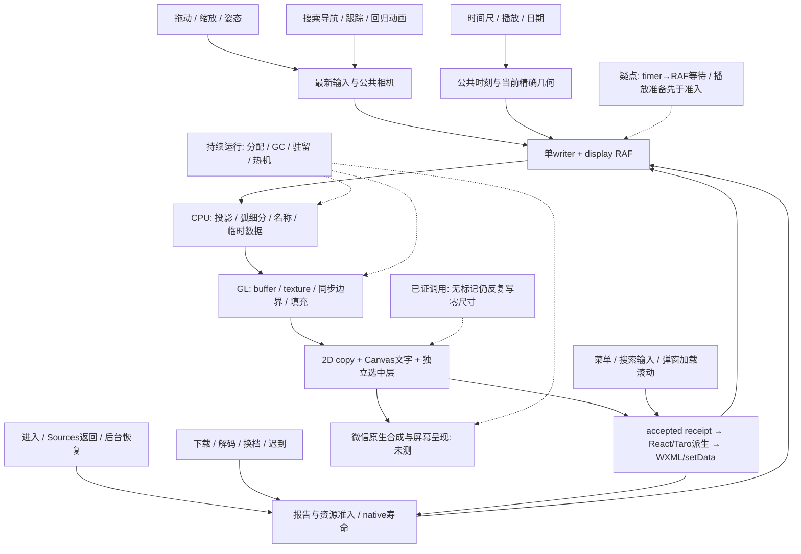

# 云观星整体性能与流畅度调研

2026-10-16。范围按用户追加要求扩为完整使用过程，拖动仍为最高频、最高优先级。本文是研究与实施建议，不是第二份实施 PLAN，也不启动或续跑原完整 Goal。

## 1. 判断与证据身份

**当前最值得先检查并局部处理的是同一呈现链上的多余工作和时钟协调。** 当前主 writer 的 display Canvas RAF、最新拖动输入、按需绘制、准确时刻复用及批量 GL 提交确实已经接通。发现三处具体检查点：选中层无标记时反复写零尺寸；非导航动画采用 `16ms timer → RAF` 双重等待；时间播放由独立 16ms interval 推动 React 和新的时间 Scene，尚未按实际绘制准入合并准备工作。第一项确定有重复调用；后两项的目标性能影响仍需测量，不能直接解释所有快速拖动，尤其密集 touchmove 会主动续约 writer。

**尚不能确定 r368 当前元素密集场景的单一主要瓶颈，也不能保证上述局部修复能解决整场卡顿。** 历史设备数据已经证明局部 CPU 提交耗时之外还存在有成本的图形完成/上传等待，刷新节奏也曾显著影响观感；当前新增星数、全天星座及独立 Canvas 的实际原生合成、GPU 时间、热机和长时资源表现仍缺证。

证据标签：`S` 当前/固定源码可确认；`O` 已有运行观察，严格保原版本与输入；`P` 本次隔离执行，仅证明机制；`I` 因果推断；`U` 待测。源码中的调用存在、一次局部耗时和真机流畅度是不同层次。

- 工作区仅 `E:/dev/worktrees/Starward/remote-main-20260908`，分支 `codex/remote-main-20260908`，HEAD `b73523f1c76bf50a3811fcff65f3e2d2f791373d`。分析绑定当前未提交源码，不能用 HEAD 内容替代。
- 当前本地候选 **r368**，bundle SHA256 `9cd39cba475e504a54e5298714e4d8e05a5fb79c8eff3945e9e1e4d7e9694ecd`；最后实际手机普通版 **r322**。r368 未推手机；旧模拟器 s3/r347 不代表当前输出。以 [CONTINUE](../CONTINUE-CLOUD-SKY.md) 和 [r368 读回](../../../../output/cloud-sky-native-updated-ide-2026-10-12-r1/r368-interaction-readback.json) 为准。
- 当前唯一 [PLAN](../PLAN.md) SHA256 `35b9449db1c20b7ba8724524fb5ff01d169fb63ae3939a782ff7e800b7036ab2`，本次未改。已读 AGENTS、global、Context manifest、性能/生命周期/维护边界、相关 Sky 合同与既有计划；使用项目小程序开发及交互技能限定证据。
- 运行证据主要复用[拖动节奏](drag-cadence-2026-10-16.md)、[最近交互与星数](interaction-refinements-2026-10-16.md)、[原纹理/时间/SAO采用裁决](resume-implementation-2026-10-14.md)、[Sources寿命](r1-source-owner-integration-decision-2026-10-06.md)、[联合导航](search-navigation-motion-2026-10-16.md)。只按具体问题取相关段落，没有递归重读全部交接。
- 本次只新增本报告、[隔离脚本](drag-research-2026-10-16/mechanism-probes.cjs)、[结果](drag-research-2026-10-16/mechanism-results.json)、[源码指纹](drag-research-2026-10-16/source-baseline.json)及最终文档核验回执。实验目录沿用起始拖动研究名称，内容随本文覆盖共用机制。没有生产插桩、构建、IDE/手机操作、Goal 操作、提交、上传、部署或素材获取。
- 未取得新的独立审查。当前 Code Review 工具仅能读取 PR CI 诊断，不能审查本地研究；本文经过作者自查，不冒独立审查或产品验收。

### 已证实、已解决、可疑与无依据

| 分类 | 结论 | 证据及限制 |
| --- | --- | --- |
| 已证实的历史关键机制 | display RAF 相比 timer 的窗口呈现更均匀，copy 更少仍可能更顺 | `O` r272 同包：timer/RAF copy 143/108，AppBrand 窗口间隔 median 24.961/16.642ms、P95 33.282/24.968ms；RAF 单次 max 41.604ms 反而较长。窗口不是 Sky-only、120Hz 显示周期也不是应用 120FPS。用户倾向 RAF。[拖动证据](drag-cadence-2026-10-16.md) |
| 已解决并仍生效 | 单 writer、最新手动 refs、稳定空 HiPS、普通目标重复投影、线段直接写入、尺寸矩形复用、准确时刻球弧复用 | `S` 已逐项核当前消费者，见第4节；不是新建议。历史 40°顺畅、115°快速“已经不明显”、95°向上“好了一些”保各自范围 |
| 已证实的多余调用 | 无标记的独立选中 Canvas 每次 `present` 仍写 `width=0;height=0` | `S/P` 120次提交产生240次零尺寸 setter 调用；未测 setter 在微信的成本，不等于主 Canvas 反复重建 |
| 已证实的时序、收益待测 | 非导航过渡先等16ms再请求 RAF；播放 interval 也独立于 writer | `S/P` 无连续输入的虚拟60Hz时钟会多等周期；密集输入反例会覆盖等待。播放准备是否过量、原生收益待测 |
| 已证实的历史同步成本 | 新纹理及其错误检查可能占交互帧；CPU 提交不覆盖全部完成等待 | `O` r118 单8MiB upload wall19ms；r298首次身份上传后检查 mean4/max5ms；r288临时 finish mean3.92/max13ms。三者不同样本，不能相加，也不是纯 GPU timer |
| 已证实的新增负载 | 当前宽视野真实星点与全天星座增加实际工作 | `O` r330→331的115°软件场景：SAO候选8→73片、submit1588→3002；r338全天264.4°：72插画/1972线段；r366暮光提交317→1350。条件不同，不合成一个“最坏帧”，未验手机 |
| 可疑待测 | accepted receipt 导致整页派生、资源选择/到达重组、临时对象与 buffer 上传、GPU填充/复制/原生合成 | `S` 存在工作链，`O` 旧局部阶段有成本，当前占比与 GC/物理峰未知；不能全部称主因 |
| 无当前依据 | 主图每拖一帧测布局、重设主 backing；每颗星一个 draw；普通拖动每帧跑完整星历或等待网络 | `S/O` 当前热路径和 r274/275 controls/surface 查询0不支持这些说法。时间变化/冷进入与固定时刻暖拖动必须区别 |
| 无当前依据 | 已确定 GPU-bound、GC 是主因、监听泄漏、独立 Canvas 免费或一定更快 | 缺有效 GPU timer、当前 heap/原生合成/长时读数。旧21 listeners是未闭观察，不是当前泄漏判决 |

不重查用户已停止追查的 r315 搜索接管旧例；其历史 FAILED/UNKNOWN 保留。以下只研究当前共用机制。

## 2. 场景—工作链—证据矩阵

场景按机制归并，不能把每个倍率、对象、图层另变成一次研究循环。

| 场景 | 主要工作链 | 已知瓶颈/疑点 | 现有证据 | 缺少什么 |
| --- | --- | --- | --- | --- |
| 首次进入、冷缓存 | Context/报告 → 几何及目录准入 → 首个可用 Scene → 测量/native上下文/懒shader → GL/copy；图片逐步到达 | 网络/文件校验、JSON解析、首次精确转换、shader编译和上传都可能串行占用；“首图”不应等全部照片 | `S` 有无图/独立图层恢复；`O` r115/r118冷owner阶段TOP既有无上传37–43ms，也有单项上传长帧 | 当前 r368 从进入到可用可交互画面的分阶段时间、实际非空负载及冷/暖身份；不是整小程序冷启动 |
| 再进入、Sources返回、前后台 | Query/encoded可复用；Sources专用retain → 暂停 → show重新验证node/GL/DPR；普通后台/退出释放native后重建 | 错把encoded暖缓存当decode/GPU暖；不必要重建/重传与错误保留都可能有害 | `S` 生命周期已分开；`O` R1完整软件消费者首Back像素一致、零acquire/context创建，r278/r302等有限原生返回成立 | 当前候选真实零/必要重新下载、decode/upload次数，返回首可用画面、完整原生层、反复进入的监听和内存 |
| 普通/快速拖动、反向、双指切换 | 原生事件 → 手势事务/refs → 同writer RAF → 当前相机投影/裁剪/布局 → 批量GL → copy/Canvas字/原生合成 | 高DPR、宽视野点/线/画负载；事件队列年龄；选中层零尺寸写；React派生与资源到达 | `S` 最新状态合并已接；`O` 旧115°/95°有限改善；`P` 无标记重复尺寸写 | r368密集场景的输入年龄、提交间隔尾部、同条件用户感受；多指/快反向只补受影响事务，不穷举 |
| 搜索导航、跟踪、随手机、校准/手动接管 | 位置查询/本地投影 → 共用相机轨迹或过滤姿态 → writer → accepted相机；原raw姿态负责校准 | 原生事件→React→draw有额外边界；非导航回归/过渡有timer等待；长任务后导航>100ms步长保护可能延长动画 | `S` 搜索共同短弧/FOV轨迹、accepted起点/中断和原姿态滤波均在；`O` r312导航、r319慢放仅各原范围 | 原速输入→可见响应、姿态sample年龄/滤波延迟、动画完结后dirty/回调是否归零；不重演r315旧例 |
| 时间尺、播放/暂停、日期/昼夜 | 公共time owner → 16ms tick或尺输入 → MODEL/EXACT几何 → 当前BSC/SAO/星座转换 → 光照/地景/选择/页面 → writer | 播放在绘制准入前就推动整页新Scene；新时刻不能复用旧ENU，但静态出版/图片不应重建；fine-target恢复有独立请求 | `S` 模型准入按报告WeakMap一次，播放/拖尺期间fine-target query停用；星座拓扑/UV静态已复用；`O` r110换时刻局部节省、r113时间尺旅程 | 生产tick/准备次数相对accepted次数、首可见响应、日期切换及昼夜资源到达长帧；1x时间和逐帧身份不得牺牲 |
| 菜单、搜索、说明加载/滚动、弹窗进退 | 同步披露命令 → 有界CSS动效/保挂载状态 → 懒查询 → 固定阅读视口/native滚动 | 页面仍共享状态根；搜索输入每字符更新父state；透明覆盖下跟随/资源可能仍合理活动；nextTick不等于绘制完成 | `S` 菜单/列表/图层打开会pauseTime，搜索250ms去抖/confirm立即，失活查询与旧结果点击有守卫；弹窗只按标题/尺寸等测header；`O` r322局部遮挡已修 | 当前原生首响应、弹窗真实进退/加载撑开、滚动时后台帧及setData成本；不能从CSS代码认定合成线程完成 |
| 资源到达、换档、失败、取消、GPU重建 | 现需求 → 统一encoded缓存/I/O → canvas.createImage解码 → 原纹理owner上传/窗口 → ready渐显 → accepted来源 | 多家族独立并发、同批完成和SAO全量聚合；旧取消finally也可发布；大量当帧可见资源受保护可能超过soft压力目标 | `S` 身份/取消/迟到/保粗/退休已实现；`O` r118至多一项新上传、r298非窗口重建；这些不覆盖当前全天新负载 | 有效到达是否同帧堆积、解码callback与上传分离、第一次可见等待、错失帧与资源事件相关性、当前同时驻留 |
| 静止、仅呼吸、持续浏览、反复进出 | clean writer应停止；CSS呼吸不要求Scene；可见姿态/遥测/Query边界仍可能更新；退出清理 | 普通idle、传感器有效变化、播放和CSS呼吸不是同一空闲；热机下降与泄漏不能用短样本推断 | `S` writer无clean循环；1s compass年龄UI仅前台且有历史样本时活动；hide停传感器、时钟和native；`O` r290空闲RAF通道仅历史局部能力 | r368实际idle提交数、CPU/原生层活动、长时斜率/进出残留、耗电与温升；不能以对象handle归零冒驱动立即释放 |

## 3. 共用瓶颈图

图中“疑点”表示需要分段证据，箭头不是已测耗时。一次修复应沿共用owner覆盖实际消费者。

最广的共同影响面是 `CPU准备 → GL → copy → accepted整页派生`，覆盖手势、自动运动、时间、资源到达和恢复。时钟修复主要帮助自动驱动/过渡；选中层幂等性覆盖所有主图提交；资源寿命修复同时影响加载速度、返回、运动尾部及内存。菜单滚动本身不该自动被归到星座几何热点。

## 4. 六条跨场景主线的源码结论

### 4.1 输入、调度、端到端延迟

当前真实链路（[Page][S-page]约1398–1795、2249–2279、3198–3328行；[lifecycle][S-life]）：

1. 一次手势捕获起点相机/策略和Context/time/generation。touchmove计算当前drag或pinch，把 `manualBasisRef/zoomRef` 更新后调用 `browsingDrawRef`；首次进入manual和结束/取消才做相应控制state提交。没有把每个move存成历史绘图队列。
2. `request`替换 `latest`，`dirty/busy/scheduled`共同保证一个writer与一个已安排准入。`paint`取最新帧；Page再次读live手动refs/校准状态，避免把过期请求相机当已绘相机。warm paint及Scene是同步调用，不await网络。
3. Scene完成→lifecycle `presented`→`surface.present`执行GL flush、WebGL到2D drawImage、文字、选中层→成功返回才提交相机/名称/拾取/来源。这里的accepted是软件成功边界，**不是原生屏幕完成信号**。两个native Canvas顺序调用也不是原子合成证明。
4. accepted仍触发 `setPresentedCamera/setPresentedSkyFrame`等，React再进行资源可见性和其他UI派生；真正资源变化可再次请求。不能把所有第二次request都称无效，也不能把React render次数等同setData次数。

姿态不是完全相同的输入路径：[use-sky-orientation][S-pose]先更新 `latestPresentation`，再经 `createPoseFramePublisher` 的零延迟timer合并发布React；draw/paint有live控制守卫。但普通姿态采样可能仍经过React后才能产生新draw。它已有过滤和合并，不能再建议“增加第二层滤波”，也没有测到sample到屏幕的延迟。

**新增基础问题A：过渡双时钟。** Page1691–1693：导航动画直接请求同writer；回归相机/星点/名称/资源reveal则先setTimeout16。当前已用display RAF，后者不再只是“约16ms一个帧”，而可能在工作完成后错过下一次refresh。

**新增基础问题B：播放生产者与显示分离。** Page1917–1930、2441–2446的 `setInterval(advanceSkyTime,16)` 调用公共owner.tick并setState，`presentSkyTime`和新时刻Scene准备发生在writer准入之前。代码注释“reuse native cadence”不等于实际接线。能确认独立生产路径，不能确认每次tick都完成了一次React render或都浪费。若prepare次数明显大于accepted且影响响应，应让同一公共owner在有效呈现需求中取最新墙钟，合并未显示的中间准备。

这项不是简单把 interval 换成另一个RAF：`RAF → setState → effect → writer RAF`可能再多等一帧。应先明确准备与提交谁拥有一次帧，不增加第二时间源/常驻循环，保1x、暂停、coverage、Context提交和同帧来源。参见第10节。

**本次隔离执行：** 脚本加载当前完整 `sky-canvas-lifecycle.ts`，注入理想60Hz虚拟Canvas和timer，不测真实时间。连续100次request在第一次paint前合并为最新revision100。纯动画驱动时，6或10ms模拟工作下，`timer16→RAF`间隔33.333ms，直接续约RAF为16.667ms；18ms工作时为50/33.333ms。hide/dispose后均无pending任务。8ms一条密集输入的反例，输入活跃段仍可按16.667ms准入，因此不能拿纯动画模型声称快速拖动翻倍。模型不包含微信事件派发、React、GPU和屏幕。第一次dense断言误漏首RAF前的两次输入（应102而非100），已修研究夹具，产品未变。

### 4.2 CPU、重复计算、分配与GC

| 数据/工作 | 当前寿命与消费者 | 判断 |
| --- | --- | --- |
| BSC出版、颜色、排序证书；星座拓扑/成员/UV | 准入出版身份WeakMap；真实Scene与名称消费 | 已有且生效；不重复校验整库/重建拓扑，不照搬Stellarium重新选星表 |
| BSC/SAO方向、透射；星座ENU/配准 | 准确场景/时刻或tile最近geometry；方向/透射lazy；冻结lines弱寿命角细分 | 暖固定时刻drag复用；时间尺/播放的新精确时刻需要重算。不能用取整时间或历史frame缓存替代 |
| 当前相机投影、地景mask/弧裁剪、名称避让 | 每帧；普通目标页外重复投影已退出；完整名称/当前框命中保留 | 有必要的随相机工作，仍须按阶段找重复；新全天星座扩大工作，不能按旧“广角退场”估算 |
| 星点过渡、pick对象、顶点number[]→Float32Array | 每帧新数据；transition保accepted detached snapshot与短退出 | Scene每可见星创建展示对象，transition有快照/记录，pick另有对象；`submit`动态数据仍new Float32Array。存在分配压力，尚无当前GC trace证明卡顿归它 |
| SAO选片及到达聚合 | 选片随相机；Hook按ids键/已载tiles重组；每tile最近精确转换；聚合frame新建points/direction memo | 稳定选片并非每帧重转整库；但选片变化/每片到达可重组全部当前points并重建lazy memo。取消finally也会publish新tiles数组，需要核“同内容的新身份”是否造成实质重组 |
| 字宽、字距和标签表 | Canvas measureText；星座字距逐glyph测量，present可再次测advances；布局限制与reveal在原owner | 可评估同Canvas/font/text/spacing的有界metrics复用；不能按Stellarium atlas宣传必有收益。旧名称准备mean约0.38–0.45ms，仅旧90°范围 |

主要入口：[Scene][S-scene]、[BSC][S-stellar]、[SAO聚合][S-sao-frame]、[SAO Hook][S-sao-hook]、[星座][S-const]、[弧][S-arcs]、[过渡][S-transition]。还存在小型 `.map/filter/find/sort`、JSON身份键、Date.parse遍历；应先测责任整体，不能把每个临时数组都立为一个修复项。

宽视野供给已经改变 r138 SAO裁决的负载条件：旧代表为4/20/45°，当前115°候选显著增加，允许重评当前候选/聚合成本；**不因此直接批准排序、池化或空间索引**。很多星等早筛、空间分片和lazy方向已在真实链上，先量还剩什么。

### 4.3 GL、复制、透明合成与DPR

- [renderer][S-gpu]复用program/buffer，点与线批量提交；`segments`直接写入，固定矩形按buffer+尺寸保上传信用。不是逐星draw，也不是每帧创建所有VBO。动态点/线仍逐批 `bufferData(new Float32Array(...))`；数据随相机变，不能直接套静态散点图的“只上传一次”。
- 星座插画仍按图片提交并切换纹理/混合；已有 `skyArtworkRasterBounds` 的保守framebuffer scissor（不确定/反极点回退完整视口），不能再列“增加scissor”为缺失。每个可见图片的准备、shader片元、状态和纹理绑定仍有成本；source alpha、加法/覆盖语义限制任意排序合批。
- 暖纹理命中返回已有handle，不走texImage2D。错误检查主要保在分配/可选pass/整帧等边界；普通简单插画并不是每张warm图必查getError。readPixels确实存在于合格贡献/局部观测分支，受budget/enabled/entries控制，不能认定普通全景每帧都readback，也不能忽略启用真实Prepared/HiPS消费者时的同步代价。
- `surface.present`显式 `gl.flush`后drawImage复制，再画同帧Canvas字；`preserveDrawingBuffer:true`服务于当前offscreen→display架构。flush、drawImage返回和GPU完成不等价，浏览器“RAF无需flush”也不能直接搬到两个WEAPP Canvas的交接。当前无证据删除flush/getError或改preserve策略。
- DPR/backing只在创建/验证/resize等owner更新主图，暖拖动没有尺寸查询循环。390×844、DPR3每个RGBA backing为11,849,760B（约11.30MiB）；两个主backing加选择层的逻辑账明显不同于16MiB纹理soft目标，不是驱动物理总量。没有证据以降DPR、减少真星点或省图层换“顺”。

**新增基础问题C：无选中时重复尺寸写。** [selection-reticle][S-selection]36–64行的 `paint(null)`总调clear，clear无条件把context置空并写零尺寸；[surface][S-surface]205行每次present都会调用。当前完整surface+selection owner的计数端口观察如下：

| 输入 | 选择层尺寸setter | context取得/笔画 | 证明范围 |
| --- | ---: | ---: | --- |
| 无标记连续120次present | width120 + height120 | 0 / 0 | 重复调用确实存在，backing一直0 |
| 有标记连续120次present | width1 + height1 | 1 / 120 | 有标记时没有每帧重建；局部clearRect负责移动 |
| 撤回一次，然后再120次无标记 | 撤回2次；后续又240次 | 后续0 / 0 | 可把“已经释放”作为稳定状态，避免重复写 |

不修改当前生产实现。建议下一实施让clear/零尺寸退休幂等，只在需要撤回backing/代次时写；不改变有标记的尺寸、几何、触摸和fallback。选择层 CSS呼吸已不触发整片Scene，额外native backing/透明合成仍需真机。两个Canvas各自顺序成功不能承诺同一物理扫描帧。

### 4.4 React/Taro/WXML/setData与布局

`setPresentedSkyFrame`包含名称/点/来源等比较，`setPresentedCamera`逐实际相机变化。移动时确会更新父Page，进而派生可见插画、SAO需求、光学/地景状态及WXML方向字、诊断data属性等。`catalogFrameObjects`在搜索列表未开时直接空返回，普通target投影也有模式判断，不能继续把这些旧工作写成缺失优化。

本地 **Taro4.2.1** `@tarojs/runtime/dist/dom/root.js` 的 `pendingUpdate/updatePayloads`先合并，`scheduleTask`用timer，最后按page/CustomWrapper setData。当前React18已走相应批处理的旧源码证据可复用；没有理由再外包一次batch。React Page调用、React提交、Taro payload和微信更新区间应分别记录。

旧r274/275控件及surface查询0，更新API work约1ms均值；这些不证明WXML成本占主导，也不证明渲染层没有布局。[ObjectDialog][S-dialog]的header测量只受标题/副标题、show/resize等触发；描述正文滚动未接每帧测量。四方向WXML `left/top`确会随相机更新，普通名称已Canvas；把四字改transform属于条件候选，不能只凭浏览器布局规则宣称微信立刻改善。

更合适的边界是：权威accepted对象/命中/来源继续同步更新，只有真正消费变化的UI子树接收必要字段。先在原生更新统计中确定字段类目和估算字节、Page派生CPU，才选择局部组件/memo或CustomWrapper。不要节流权威receipt或让名称/点选落后。官方文档的全局baseLevel、编译模式及React19新特性不是当前4.2.1/React18的默认修复。

### 4.5 资源、冷暖与时间变化的寿命

[公共encoded owner][S-image-runtime]已有环境+SHA+格式身份、32MiB encoded政策、16MiB单文件及同时I/O字节政策；JSON/图片复用现owner，取消保留真实native槽直到完成。文件暖缓存不能免除校验、parse和native decode；同一Canvas可复用native image，后台重建不能借别代image继续画。

`useSkyNativeImages`按canvas/revision/hash/active持有loader；普通wanted更新不重建loader。原 `sky-artwork-loader`有2并发，SAO有3并发及6MiB工作集，**不是全页面总并发为2或3**。每家族done会emit/pump，可能与输入、React、GL争主线程；是否同帧堆叠需新数据。有效wanted/frame pin可超过纹理soft压力目标，不能把16MiB写成硬上限或擅增缓存。

Sources与普通后台有意采用不同寿命：Sources停新工作保ready并撤旧pick/source；show重测并验证node/GL/backing，失败才重建。普通后台/退出释放；沿同owner恢复，不引入截图回贴或全局“永驻一份天空”。当前纯时间变化不应让所有静态图像退休，现loader effect与Query键已经大体区分此事；真正的LOD、源、地点/日期、原生代次变化仍须改变需求。

时间MODEL每次新at会重建单瞬间几何并重新推当前恒星/星座；这是不同于拖动的实质成本。`skyPresentationTimeModel`只按报告准入一次；播放/拖尺不逐帧取整日报告或完整远端位置查询。选中/跟踪通过固定anchor query与本地投影；停止播放后的fine-target可单独查询，不能误报“每帧打API”。

### 4.6 持续运行、空闲和热机

writer clean不安排RAF；导航finished不续约，有限reveal结束不再timer续画。仅CSS呼吸没有新JS时钟。有历史传感样本的前台Page仍可能每1s更新sample年龄，跟随开启时真实姿态变化继续派发；这些不能与“完全静止且手动、无播放无未完成资源”的idle混测。

`useSkyOrientation`卸载dispose publisher/controller；compass-lifecycle按port共享coordinator并有off/stop；Page hide同步撤销时钟/会话、取消手势与writer，再释放或暂停native。源码可确认清理路径，不能确认每种微信异常下native监听、heap、driver都立即回收。冷warm切换、反复进入后实际监听/RAF数、资源稳定后的驻留斜率、热机输入延迟及能耗仍需连续同会话设备证据。先不缩短GC策略、随机延迟释放或增加常驻缓存。

## 5. Stellarium：真实路径与迁移限制

复用既有Web只读checkout和桌面源码材料。Web独立Git根目录及HEAD确认为 `7d45c8fec393fbbabadcefa935794290fc39723d`，所读路径工作树干净；桌面材料固定 `8e3062e220808537936e492b108dabaed0c3faa4`，不是独立Git checkout。当前读取的StelMainView.cpp同时通过已存source-manifest SHA256及固定tree Git blob校验，不能用在该目录继承到的Starward Git HEAD认版本，实际校验归最终回执。没有拉取/泛审新仓库。本次不需要用更新版推翻这些特定路径，因此不宣称它们是2026-10-16最新版本。官网前次frontend1.16.0/libswe1.17.0只属历史观察；商业移动版没有对应源码，不向它归属以下实现。旧[研究](stellarium-source-architecture-performance-2026-10-14.md)作导航，以下路径实际重读。

| 场景/机制、固定文件与函数 | 它减少什么/改变什么时序 | Starward现状、适用性与代价 |
| --- | --- | --- |
| 启动：[App.vue][W-app] mounted动态导入WASM → [sw_helpers.js][W-ui] initStelWebEngine → [pre.js][W-pre] onRuntimeInitialized/core_init/onReady | Web应用内一个engine上下文、UI就绪与后续数据分别启动 | Starward本来就有Page/native生命周期及逐步可用内容；不把Web单例变成跨页面永驻GPU。先区分入口网络、准入、首Scene、资源完整度 |
| 拖动/连续缩放：[canvas.js][W-canvas] render → core_update/core_render；鼠标最新位置在帧中消费，touchmove直接送core | 渲染与浏览器刷新对齐；鼠标消费合并，但不能说Web所有触摸都RAF合并 | Starward显示RAF/手动最新refs已有。触摸仍需本地事件年龄测量，不能只看到函数名就认同所有输入接线 |
| 自动导航/跟踪/时间：[navigation.c][W-navigation] core_update_time/direction/fov，由core_update_observer调用 | 同一次update推进时间、方向、FOV；dt驱动，结束撤动画状态；锁定目标更新落同观察者 | 共同时钟协调值得借鉴；Starward已有更符合合同的球面短弧+联合FOV轨迹，不替换其算法/参数。独立播放tick与非导航timer是当前可复核差别 |
| 精确观察者：[observer.c][W-observer] observer_compute_hash/update/full/fast | 多处调用时按实际依赖hash避重复，而非靠函数名假设每次都重算 | 当前BSC/SAO/星座准确时刻模型已有类似寿命复用。Web还存在fast天文更新策略，不迁其时间近似或科学精度边界 |
| 星表/投影：[stars.c][W-stars] create_tile按vmag排序；render_visitor先tile裁剪/最亮星等，再早停、CPU位置/投影；paint_2d_points → [render_gl.c][W-render] render_points_2d/item_points_render | 获取前空间/星等剪枝、可见点批量；同星等外观少算 | Starward空间分片/星等早筛/BSC有序break/点批量已有；SAO排序无证书。不能为了用break直接对旧tile假定有序，也不照抄4096点上限漏星 |
| 缩放/加载：[hips.c][W-hips] hips_get_tile_/texture路径 → assets/request_js → worker_iter → texture_from_data | 父档、ready纹理、当前引用和异步网络；细档按需求出现 | 保粗/取消/身份/ready已具备。默认无pthread的worker_iter同步执行；不是“Stellarium已经worker化所以我们也应迁”。访问次数延迟不等于墙钟去抖，16请求/256MiB也不迁 |
| 名称/UI：[labels.c][W-labels] labels_render/fader/当前bounds；[render_gl.c][W-render] render_text；[sw_helpers.js][W-ui] onValueChanged按path更新Vuex | 绘制名/点击bounds与对象一致，保淡化；GUI属性通知与天空绘制有各自消费者 | Starward同copy名称/当前pick已在。Web默认字形atlas与平台整串缓存是两条分支；不承诺一次draw/零重排。Vuex是在现tree上改path，不是每帧getTree深拷贝，也不是UI完全不更新 |
| 空闲/呈现：Web canvas.js总是再请求RAF；桌面[StelMainView.cpp][D-view] drawEnded/fpsTimerUpdate/updateQueued/needsMaxFPS | 桌面一个待更新，按活跃需要安排节奏；Web此wrapper持续运行 | Starward按需writer更符合当前idle目标。Qt/macOS事件循环和2.5s策略不移植；[桌面#2778][C-stellarium-2778]说明帧率尚可也会输入迟滞，须测事件/调度而非只看平均耗时 |

几个必须拒绝照搬的反例：Web canvas.js用CSS尺寸比较backing、再乘DPR写入，DPR>1可反复resize；render_gl部分批次临时建删GL buffer；默认worker同步；文字碰撞仍逐标签比较，非神奇全局索引。Starward主backing已有正确owner，简单draw状态清理省略试验也已无收益退出。公开源码可提供方法，不能证明官网/移动版速度，也不授权复制AGPL/商业实现、换引擎或用其目录/图片。

## 6. 社区案例与平台核实

公开检索日2026-10-16。优先使用作者工程案例、项目issue及官方文档/源码；历史案例的设备、框架版本和结论不自动外推WEAPP。

| 原始问题/版本与来源 | 核实的机制与本项目裁决 |
| --- | --- |
| [Mapbox #7893][C-sync]，2019，共用外部动画循环与同步重画；MapLibre v4.7.1的[map.ts][C-map]/[browser.ts][C-map-clock] | 固定版本triggerRepaint以单个_frameRequest申请RAF，回调清句柄再_render。支持共用帧需求/合并，不支持再建第二循环。Starward基本已有，重点在动画续约与准备阶段是否真正使用它 |
| [MapLibre #96][C-layers]，2021，Mapbox1.x静态底图+动态overlay；[MDN Canvas][C-canvas] | 分层收益来自各层更新频率不同；作者也报告高DPI多Canvas问题。相机持续拖动时天空多数层都变，不能冻结背景照搬；现独立呼吸层有明确独立变化理由，仍需原生成本 |
| [Mapbox #6474][C-idle]，2018，Windows10/多浏览器Canvas animate导致高占用 | 维护者解释animate会持续请求重画；静态源应停。Starwardclean writer已有，须区别资源reveal、传感器和普通idle，不能引入永久RAF“保顺” |
| [D3FC实际性能分析][C-d3-gc]，2020-01，约54k点、Chrome，pan时GC；[百万点案例][C-d3-buffer]，2020-05 | GPU绘制仍可能被每帧数据验证/数组重建阻塞；用真实数据变更边界避免重处理。Starward静态验证已搬到准入，但transition/pick/动态上传和到达聚合仍可查。静态GPU数据只适合相机变换能移入shader的实现，当前CPU屏幕点不能直接跳过上传 |
| [Taro优化文档][C-taro]，4.x站点，部分段落仍讨论3.x历史；本机runtime4.2.1 | setData量/频率、引用稳定、局部CustomWrapper都有真实机制；框架已batch。局部原生组件会改变flex/选择器边界，不能未经数据改全局baseLevel，也不照文档打印私有payload |
| [ECharts微信 #660][C-wechat-layer]，2020，多2D图滚动卡/漂移；[#963][C-wechat-event]，2025-08，建议catch touchmove | 前者是被标平台问题的历史报告，说明工具/真机和合成不能混论；后者没有量化对照，只作事件冒泡线索。Starward主Canvas已disableScroll，不能未经真实冒泡/手势证据直接改catch并影响多指/Back |
| [PixiJS8性能指南][C-pixi] | batching会受混合/纹理次序影响，culling在CPU-bound时也可能更慢。Starward已有scissor/culling/批点，进一步合批必须保光学合成、来源和失败语义；不导入Pixi引擎 |
| [MDN WebGL最佳实践][C-webgl]、[Khronos实例化规范][C-instancing] | getError/getParameter、上传、readback可能成为同步边界；扩展不是当然支持。现必要错误确认和历史Android属性数组恢复不能删除；实例化对已一批POINTS不会自动减少draw |
| [React memo][C-react]、[Refs][C-ref] | 只对实际稳定props/昂贵子树有效，refs不触发React更新。在线文档为19.x；本文只用18.3.1已有基础语义，不采用19的Action/Compiler假设。不能把startTransition当重计算后台线程 |
| [Google输入处理][C-input]、[动画合成][C-animation]、[长任务][C-long-task] | 保输入轻、取最新值；transform/opacity可能绕过浏览器layout/paint，但层有内存/合成代价；Promise微任务不会自动让出渲染。它们是Web机制，WEAPP需native数据更新/原生层证据，不能声称50ms以下就适合60Hz |
| [MapLibre VideoSource释放修复#7279][C-memory]，2026-03-18合入，merge commit `5fd5cde` | remove不仅放开渲染对象，还需撤事件、暂停媒体。只借“按同owner查计时器/事件/资源”的方法；Starward没有这条VideoSource，也没有据此发现当前泄漏。另一#7286页面一次超时，未把二手摘要当已核源码 |

Worker平台核实：本地官方 `miniprogram-api-typings@3.12.3` 的OffscreenCanvas列createImage/getContext/尺寸等接口，Worker.postMessage只有message参数；它没有证明浏览器transferControlToOffscreen/transfer列表零拷贝在此小程序成立。官方Worker和OffscreenCanvas网页本次各一次不可取，已停止；未反复重试。当前app project.config为trial基础库，也不能靠声明版本判实际手机能力。浏览器[OffscreenCanvas/Worker教程][C-worker]和[Three.js示例][C-three]有完整transfer前提；`wx.createOffscreenCanvas`已有并不等于工作已在另一线程。适用性结论为**未验证**，不是宣称微信所有Worker方案都不支持。

## 7. 与当前源码对应的候选表

预期作用指减少的工作/等待，均不是承诺FPS。`局部`仍须在后续获得实施范围后再改，本次不整改。

| 候选/问题 | 当前证据与owner | Stellarium/社区方法 | 适用性、预期作用 | 代价/条件 | 验证方法 |
| --- | --- | --- | --- | --- | --- |
| C1 选择层重复零尺寸写 | `S/P` surface→selection.paint(null)→clear，120帧240写 | 生命周期幂等，Canvas backing只在变化时设置 | **明确可局部修**；所有主图帧减少无意义native setter；不是承诺大幅拖动提升 | 低；保初始化、撤回、故障、hide/恢复与有标记lazy分配 | counted-port旧数→稳定inactive零写；受影响surface/selection现有检查；手机无/有标记相同drag/原生层 |
| C2 非导航动画timer→RAF | `S/P` Page1693，纯动画模型多等周期 | Web update/render同帧；MapLibre单frame demand | **接线可改**；回归、名称/星点/资源reveal停手后的节奏；密集drag未必受益 | 低至中；用原writer/取消代次，不能永久循环；续约频率上升可能增功耗 | 有限reveal/return各一种；idle回零、hide取消；同负载间隔尾部/完成等待/CPU占比 |
| C3 播放准备未按显示准入合并 | `S` interval→timeIntent→MODEL→新Scene→writer | navigation.c在一次update推进时间/方向/FOV；只消费最新需求 | **值得先做有界设计试验**；减少未显示精确时刻的重复准备，改善播放、拖尺及同时资源到达响应 | 中；不能简单加另一个RAF或延迟一帧；公共时刻/来源/命中/1x/结束coverage保持 | tick、MODEL/恒星/星座prepare与accepted计数；延迟后真实墙钟1x；快滑/暂停不出旧帧 |
| C4 accepted引发的Page/资源派生 | `S/O` 当前Page状态根、旧Page约2–3ms调用，不等于native耗时 | React稳定消费者；Taro局部更新；GUI属性消费者分离 | **待当前占比决定**；减少UI反应/搜索打字与高频motion竞争 | 中；权威refs/receipt不得节流，不能漏资源需求；CustomWrapper另有布局代价 | 非敏感更新类目/字节估算、React派生耗时与setData区间分开；当前帧名称/来源/点选负例 |
| C5 SAO到达/选片聚合及无变化发布 | `S` tile终于发布新数组，Hook新frame/memo；`O` 当前115°供给变大 | 静态/时间/相机/到达寿命分开，保身份 | **条件局部**；对相同tile集合稳定输出，或同一有效帧需求合并到达发布；只减少可证明重复 | 中；不延迟首有效数据、不缓存旧视野，loaded顺序/失败/refresh也可能变化；不直接排序旧tile | 真实当前73片及少量取消，记录集合变化/重组次数/CPU；相同内容负例及新增tile/失败必须更新 |
| C6 动态点/线临时数据与VBO更新 | `S` JS顶点及new Float32Array；当前dense点多；GC `U` | D3FC寿命/上传边界；WebGL批量流式提交 | **待CPU/分配热点后局部试验**；可先减少已证重复字段/字符串/转换，后评估有界scratch | 中；不能共享可变accepted点/错帧命中；bufferSubData可等待在用VBO，不保证比bufferData快 | 生产热路径CPU/分配与同输入输出；实际上传字节/调用数，失败恢复和有界容量；不用空循环证明 |
| C7 字宽/advances复用 | `S` measure/present重复；旧文字局部成本小 | Web字形/整串缓存分支；Canvas文本重用 | **较低优先**；原surface中同font/text/spacing有界复用 | 低至中；保全名字框/字体DPR失效，不先上atlas | 当前名称最密集帧measure次数/CPU；相同font与换font/viewport，真实整字边界 |
| C8 新纹理准备调度 | `O` r118无同帧堆叠；新全天需求变大但无native数据 | 资源就绪与显示分开、保粗 | **需新堆叠证据才重开**；减少到达帧叠加，不能切开单次upload/check | 高于前项；defer必须穿透Boolean接口、不能当失败；不扩大预算/积累decode | 多有效到达同帧是否主导；交互尾部与首可见等待、decode/GPU驻留一起比较 |
| C9 GL填充、copy、独立层原生合成 | `S/O` 已scissor/quad复用，完成等待历史有成本；当前GPU `U` | 保守raster范围、不同更新频率分层 | **测量候选**；只有已定位瓶颈才改变实现 | 中至高；同像素/alpha/完整图层要求保留，native合成不可用软件替代 | 已有scissor覆盖/调用计数与current资源，copywall另记；实际窗口/视频/用户反馈限定，原生peak/热机 |
| C10 启动/返回不必要重复工作 | `S` 已encoded/Query/retain机制，冷准入有同步工作；当前多余重建未证 | Web单次init，按生命周期保已就绪资源 | **先查链再改**；减少首可用等待及错误重复下载/解码 | 未证前不做永驻；普通后台释放政策不能悄悄改变 | 同一机制冷→暖→Sources→后台一组，逐层hit/miss和重建原因，非只总加载秒数 |

复杂替代的采用条件：

| 方案 | 当前裁决与必要前提 | 影响的产品义务/成本 |
| --- | --- | --- |
| Worker / Offscreen迁线程 | 普通offscreen已有；线程/transfer/Canvas能力未实证。先有可分离CPU热点，再用目标native验证启动、消息复制/队列、最新版状态和取消 | 新打包入口、兼容、消息延迟、双端驻留与故障恢复；不能搬走渲染后又readPixels回传整屏 |
| WASM / 二进制星表 | 当前没有证据解析/数值计算主导常用拖动；不采用Stellarium实现。需实际重计算热点与native支持/包体证据 | 当前main约2,075,616B接近原2MiB预算；新增runtime/数据合同、内存和调试成本，可能改变PLAN |
| GPU星位/相机变换 | 可减少CPU投影和上传，但当前CPU仍要同帧名称/拾取/裁剪，必须说明谁保留CPU结果 | ENU/反极点/精度/地景遮挡、位置回执和动态显示参数；大幅责任变化，不先建第二引擎 |
| 文字atlas / 实例化 / 额外Canvas | atlas需文字热点、完整中文字体/字距/更新失效；POINTS已经batch，实例化不自动省draw；多Canvas先证独立更新频率 | 图集驻留/上传/字体兼容、扩展支持、完整名称命中、native合成/触摸；新增层不是免费优化 |
| 额外空间索引 / 全景截图缓存 | 现有空间分片及球冠裁剪已有，当前拾取主要在tap执行。须有实际扫描热点才索引 | 屏幕索引随相机更新可能反增CPU；旧截图不能代表当前天空/选择/来源。不得以低精度时窗或删星换快 |

## 8. 最值得先做的五项建议

排序综合日常发生频率、影响面、证据强度与实施/维护成本；不是按一个局部函数的毫秒排序。第一项是决定后续实际优化的必要测量，后四项为候选整改，全部留给原实施对话评估。

1. **先给当前密集使用链补一组有判别力的证据。** 沿原F有界observer加入最新input revision/年龄与工作原因，关联CPU准备、GL/upload、copy、accepted和有限原生更新统计。用一次宽视野快速手势+资源到达、一次自动/时间驱动以及一次生命周期/idle链回答瓶颈归属；不再测旧90°慢拖或重复失效Profiler。最高频drag必须保非空新点/线/插画/银河/地景/全名/选中，先拿普通当前候选基线，再评价局部改动。
2. **首个低风险代码候选：选中层clear/退休幂等。** 当前每个主图帧都能去掉确定重复的native尺寸写；覆盖拖动、缩放、导航、时间、资源及重建后的无选择状态。收益上限未知，不能包装成“主要卡顿已解”。尺寸/内存政策不变，风险和验证成本最低。
3. **把有限自动运动续约与当前RAF writer协调好，并单独处理播放生产节奏。** C2可先在原E局部处理；C3先做一个当前MODEL真实非空小路径，确保没有双RAF等待或独立time owner，再决定迁移。直接帮助返回/名称/资源过渡、播放和混合交互，纯密集drag的收益须由第1项证据决定。刷新更充分可能增加CPU/GPU活动，结束必须回idle。
4. **缩小accepted帧引起的页面和资源派生；优先查“同内容新身份”。** 原Page仍保权威receipt；让必要UI消费最小字段，对当前SAO到达/取消发布核稳定集合与聚合成本。相较全面React重构，这有更窄的实际数据边界，覆盖drag/跟随/播放/加载/搜索响应；收益需当前负载归因，不能一刀切节流名称/来源或推迟资源到停手。
5. **只在当前到达样本出现占优长帧时，重评原纹理/数据准备准入。** 当前全天插画和宽视野SAO改变了旧样本条件，有理由测而没有理由立即加调度器。分清单次同步stall和同帧多项叠加；前者不能靠“每帧只启动一项”解决。首可用时间、首资源可见和内存也要同时看，不能只让warm拖动漂亮。

响应/流畅/加载/内存/耗电分别衡量：

| 建议 | 响应速度 | 运动流畅度 | 加载速度 | 内存 | 耗电/热机 |
| --- | --- | --- | --- | --- | --- |
| 当前链归因 | 找到input年龄增长在哪段 | 区分均值与长间隔 | 找到首图关键路径 | 给逻辑/物理账分层 | 只在同会话有依据时比较 |
| clear幂等 | 少native setter调用，实际量待测 | 可能减少共用提交开销 | 预期很小 | 保lazy与释放，无新增驻留 | 可能少无效native活动，未测 |
| RAF续约/播放准备合并 | 少等待/未显示准备，有条件改善 | 更均匀的自动/过渡节奏 | 资源reveal更及时，非网络提速 | 不应新增长队列；可少中间对象 | 过渡绘制可能更多；必须idle停 |
| Page/集合身份 | 少React派生/跨层数据竞争 | 给高频motion让出预算 | 减少到达重组；不能拖迟首可用数据 | 可少短命对象；缓存须有界 | 预期少CPU工作，须测 |
| 到达准入 | 峰值互抢可减少 | 仅对确有堆叠的帧 | 可能延后细图；保粗须继续 | 延迟上传可能增加decode驻留 | 可削峰也可能延长活动，需联合裁决 |

## 9. 最小代表验证方案与停止点

### 指标合同

- 输入/命令序号与本地收到时间 → 帧开始消费的最新序号 → accepted-copy完成时间。仅本地同一时钟可直接相减；事件timeStamp若时间基准未校准，不拿它与Date.now硬减。原生事件入队到JS、copy到屏幕两段无API时明确缺失。JS received→accepted是端到端延迟的局部下界，不能冒输入到光子。
- 软件帧间隔报median/P95/max和分布/异常关联，区分活跃输入、过渡收尾、静止。AppBrand窗口present、编码帧PTS、copy数、RAF回调数分别列；不换算Sky-only FPS。GPU query缺失继续保缺，不重试旧入口、不上生产finish。
- CPU阶段量：input/相机、MODEL/星位/弧、Scene、标签、资源选片/聚合、GL提交/新上传/检查、copy/文字、Page派生；嵌套阶段不相加。仅保存固定类目计数、摘要，不保存原生payload、私有文字/路径。
- 数量量：真实候选/亮度合格/提交/accepted/pick、图层和资源冷暖；tick/准备/request/实际paint/accepted各自计数。warm空图或错太阳高度必须拒绝。
- 资源量：encoded、native decode、GPU texture、display/backing、在途/staging分别计；固定时点及生命周期后的斜率，与进程/驱动读数分开。没有memory API则不作物理峰/泄漏通过结论。

### 四组代表场景复用共用机制

| 组 | 最小操作与控制 | 本地能确认什么 | 必须目标运行时/手机确认什么 |
| --- | --- | --- | --- |
| V1 日常密集运动（最高优先） | 固定当前公开地点/时刻、真实宽视野约115°及显微镜座约95°两种已有不同机制视角；选一条快速450ms拖/反向，连一段双指缩放切单指；同组比较稳定warm与已有资源刚到达。DPR/实际边角覆盖/图层一致，不组合穷举 | 当前调用/数量、输出与事务、投影/弧/CPU和setter/上传计数；本次P已验证两项机制 | r368普通主图+文字+选中层实际拖动、触摸、呈现尾部及输入跟手；只能重建相近旧相机时标明非严格旧例A/B |
| V2 自动与时间驱动 | 一次已有近/远联合导航后接管，复用旧未变路径正确性；一段播放→暂停→时间尺跨昼夜，只有日期切换owner变化时再补跨日。传感器用一次实际主动转向/停稳覆盖跟随/校准 | 完成/中断/coverage、无第二writer、tick与MODEL/accepted比例、静态图片身份不因at误变 | 原速导航观感、真实姿态延迟/抖动、暂停和动画终点后的残留工作。旧r319慢放不算原速通过 |
| V3 生命周期与局部UI | 同一资源集合冷owner进入→暖再次进入→来源页返回→后台恢复；中间开一次搜索/说明，输入、结果到达、长文滚动、关闭 | hit/miss/校验parse/decode/upload边界、取消/迟到/释放/保留、同款弹窗测量与查询失活；复用R1/现失败恢复测试 | 首个可用/可交互画面、原生覆盖/过渡/加载撑开、滚动与背景活动、返回首帧及监听实际数量 |
| V4 稳态与热机 | 在V1/V3同会话接着做持续浏览、若干相同进出周期和静止/仅呼吸；先短观察驻留是否稳定，再仅为斜率/温升疑点延长到可区分的热状态 | 逻辑owner/请求/RAF/有限timer的回零及有界数据；不能逼GC制造“通过” | 真实heap/进程/native/GPU趋势、发热后尾部变化、耗电。没有可靠电量/温度源则只记观感/运行范围，不虚报节能 |

V1的两个视角覆盖当前不同负载/裁剪疑点，不要求每个FOV和所有天区。V2不是重追r315；自动中断只测当前公共机制。V3不清理用户现有缓存强造冷样本，后续用现隔离owner或已授权可恢复测试空间。V4不是固定无限压力测试；先判断是否稳定，再因真实异常延长。

本次没有可用手机，也没有运行上述产品旅程。当前已知模拟器合成失败和Profiler初始化/GPU timer缺失继续作为证据缺口，源码与纯owner实验可独立完成。不能为了“验收”反复打开同一失效入口，不能用H5重制页代目标小程序。

**停止规则：** 每个候选先提出一个可反驳的机制问题；必要的非空输出/负向恢复与有界成本对照成立后，才扩大到实际受影响消费者。顺序噪声大时先校准或做一次AB/BA，不反复采到漂亮值。移除重复调用但物理指标无可解释收益，应诚实保为局部简化或不采用，不能继续造缓存。正确性/同帧身份/恢复失败即修或撤该候选；不是放宽科学/画质。必要风险和实际目标证据够即停止，不重跑无关套件、旧批次、逐星旅程。没有设备不阻塞研究收口，也不关闭原生性能。

## 10. 原owner内局部项与PLAN边界

| 类型 | 建议归属与处理 |
| --- | --- |
| 原B/E/F内局部、无需改实施方向 | C1选择层幂等；C2在原writer内有限动画续约；证据驱动的同内容稳定引用、小范围Page消费者收窄/metrics；原F的有界观察。后续实施仍需用户另行决定，本报告不直接授权执行 |
| 原计划已有条件方向，先达到重评条件 | C8纹理准备defer；SAO额外早筛/聚合；动态buffer/分配优化。旧实验无收益不构成永久禁令，但新规模或target profile必须指出改变了什么；不能重放原条件求相同结论 |
| 可能需要细化唯一PLAN的责任/验证条款 | C3把播放精确准备移到实际帧准入或独立出页面派生owner。若仅合并原owner未显示输入且合同不变，可作为原B/E/F局部试验；若改变公共time/accepted发布、准备与提交依赖，必须先向原实施对话提交具体边界修订，再修改唯一PLAN |
| 明显改变既定架构/需要先修订唯一PLAN | 渲染迁Worker/WASM、GPU全星位/投影、文字atlas替换、更多分层/direct WebGL展示、出版格式/新索引体系、长期驻留政策；降DPR/删星/删图层/缩短全名也改变产品要求，不因性能自动获准 |

不再建议重做：RAF基础接入；普通空数组修复；已采用批量点线/矩形/弧复用；已有空间/星等/纹理身份机制；为呼吸重画主天空。r305/r306连续属性清理已大幅降disable调用却无Scene/间隔收益，仍不采用；r303重复ray-hull准备的乐观host收益小且条件有限，不为它新建mutable-view缓存。新fullscreen星座影响的是工作量，不自动推翻这些具体实验结论。旧r27对RAF平均copy的不占优结论则已被r272显示节奏/用户反馈及后续明确指示有依据地覆盖。

## 11. 可直接交回主实施对话的结论

> 本轮只完成云观星整体、多场景性能研究，未启动原Goal、未改生产源码或唯一PLAN。当前r368本地候选尚未手机验证，r322仍是最后普通手机版。主display RAF、最新拖动refs、单writer、准确时刻复用、批量点线及纹理身份已实际接通，不能重复实施。
>
> 最先应做：以当前非空密集负载补一次“输入序号/年龄→准备→GL/upload→copy→accepted/UI”的有界归因，同时把选中层无标记重复零尺寸写列为低风险首修候选；再评估非导航timer→RAF双等待和播放16ms producer在显示准入前重建时间Scene的问题。前者已有计数端口证据，后两者有源码/虚拟时钟证据；密集触摸可覆盖双等待，不能直接说它们解释了快速拖动。然后按当前profile缩小accepted整页派生、SAO到达聚合或原资源准入的实际热点，不先上Worker/WASM/atlas或额外全屏层。
>
> 这些共同owner可能改善拖动/缩放、自动运动、播放、资源到达及返回，具体收益必须分别报告响应、间隔尾部、首可用等待、内存和热机活动。保持真实星点、全部图层、完整名称、同帧命中/来源和失败恢复。源码实验、旧局部CPU与AppBrand窗口都不能保证当前手机流畅度，也不能关闭GPU/原生合成/长期功耗/iOS缺口。若C3或复杂替代改变准备/发布责任，先修订原唯一PLAN；本报告不创建另一方案。

## 资料索引

本地源码指纹以source-baseline及最终回执为准；以下链接指向当前工作区。历史证据未复制为当前实测。

[最终文档与指纹核验](drag-research-2026-10-16/research-validation.json)只检查资料、引用和源码身份，不是产品验收。隔离脚本复现命令（仓库根目录）：`node tools/run-node.cjs .codex/work-items/cloud-sky-native-2026-09-22/evidence/drag-research-2026-10-16/mechanism-probes.cjs`。它只重写自己的结果；不运行产品、计真实耗时或改源码。

[S-page]: ../../../../apps/wechat-miniapp/src/features/sky/spot-sky-page.tsx
[S-life]: ../../../../apps/wechat-miniapp/src/features/sky/sky-canvas-lifecycle.ts
[S-pose]: ../../../../apps/wechat-miniapp/src/features/sky/use-sky-orientation.ts
[S-scene]: ../../../../apps/wechat-miniapp/src/features/sky/sky-scene-render.ts
[S-stellar]: ../../../../apps/wechat-miniapp/src/features/sky/sky-stellar-scene.ts
[S-sao-frame]: ../../../../apps/wechat-miniapp/src/features/sky/sky-stellar-supplement-scene.ts
[S-sao-hook]: ../../../../apps/wechat-miniapp/src/features/sky/use-sky-stellar-supplement.ts
[S-const]: ../../../../apps/wechat-miniapp/src/features/sky/sky-constellation-scene.ts
[S-arcs]: ../../../../apps/wechat-miniapp/src/features/sky/sky-constellation-render.ts
[S-transition]: ../../../../apps/wechat-miniapp/src/features/sky/sky-star-transition.ts
[S-gpu]: ../../../../apps/wechat-miniapp/src/features/sky/sky-gpu-renderer.ts
[S-surface]: ../../../../apps/wechat-miniapp/src/features/sky/sky-canvas-surface.ts
[S-selection]: ../../../../apps/wechat-miniapp/src/features/sky/sky-selection-reticle.ts
[S-dialog]: ../../../../apps/wechat-miniapp/src/features/sky/sky-object-dialog.tsx
[S-image-runtime]: ../../../../apps/wechat-miniapp/src/services/sky-public-image-runtime.ts
[W-app]: https://github.com/Stellarium/stellarium-web-engine/blob/7d45c8fec393fbbabadcefa935794290fc39723d/apps/web-frontend/src/App.vue
[W-ui]: https://github.com/Stellarium/stellarium-web-engine/blob/7d45c8fec393fbbabadcefa935794290fc39723d/apps/web-frontend/src/assets/sw_helpers.js
[W-pre]: https://github.com/Stellarium/stellarium-web-engine/blob/7d45c8fec393fbbabadcefa935794290fc39723d/src/js/pre.js
[W-canvas]: https://github.com/Stellarium/stellarium-web-engine/blob/7d45c8fec393fbbabadcefa935794290fc39723d/src/js/canvas.js
[W-navigation]: https://github.com/Stellarium/stellarium-web-engine/blob/7d45c8fec393fbbabadcefa935794290fc39723d/src/navigation.c
[W-observer]: https://github.com/Stellarium/stellarium-web-engine/blob/7d45c8fec393fbbabadcefa935794290fc39723d/src/observer.c
[W-stars]: https://github.com/Stellarium/stellarium-web-engine/blob/7d45c8fec393fbbabadcefa935794290fc39723d/src/modules/stars.c
[W-render]: https://github.com/Stellarium/stellarium-web-engine/blob/7d45c8fec393fbbabadcefa935794290fc39723d/src/render_gl.c
[W-hips]: https://github.com/Stellarium/stellarium-web-engine/blob/7d45c8fec393fbbabadcefa935794290fc39723d/src/hips.c
[W-labels]: https://github.com/Stellarium/stellarium-web-engine/blob/7d45c8fec393fbbabadcefa935794290fc39723d/src/modules/labels.c
[D-view]: https://github.com/Stellarium/stellarium/blob/8e3062e220808537936e492b108dabaed0c3faa4/src/StelMainView.cpp#L1525
[C-stellarium-2778]: https://github.com/Stellarium/stellarium/issues/2778
[C-sync]: https://github.com/mapbox/mapbox-gl-js/issues/7893
[C-map]: https://github.com/maplibre/maplibre-gl-js/blob/v4.7.1/src/ui/map.ts
[C-map-clock]: https://github.com/maplibre/maplibre-gl-js/blob/v4.7.1/src/util/browser.ts
[C-layers]: https://github.com/maplibre/maplibre-gl-js/issues/96
[C-canvas]: https://developer.mozilla.org/en-US/docs/Web/API/Canvas_API/Tutorial/Optimizing_canvas
[C-idle]: https://github.com/mapbox/mapbox-gl-js/issues/6474
[C-d3-gc]: https://blog.scottlogic.com/2020/01/16/performance-of-a-d3fc-webgl-chart.html
[C-d3-buffer]: https://blog.scottlogic.com/2020/05/01/rendering-one-million-points-with-d3.html
[C-taro]: https://docs.taro.zone/docs/optimized
[C-wechat-layer]: https://github.com/ecomfe/echarts-for-weixin/issues/660
[C-wechat-event]: https://github.com/ecomfe/echarts-for-weixin/issues/963
[C-pixi]: https://pixijs.com/8.x/guides/concepts/performance-tips
[C-webgl]: https://developer.mozilla.org/en-US/docs/Web/API/WebGL_API/WebGL_best_practices
[C-instancing]: https://registry.khronos.org/webgl/extensions/ANGLE_instanced_arrays/
[C-react]: https://react.dev/reference/react/memo
[C-ref]: https://react.dev/learn/referencing-values-with-refs
[C-input]: https://web.dev/articles/debounce-your-input-handlers
[C-animation]: https://web.dev/articles/animations-guide
[C-long-task]: https://web.dev/articles/optimize-long-tasks/
[C-memory]: https://github.com/maplibre/maplibre-gl-js/pull/7279
[C-worker]: https://web.dev/articles/offscreen-canvas
[C-three]: https://threejs.org/manual/pages/offscreencanvas.html
