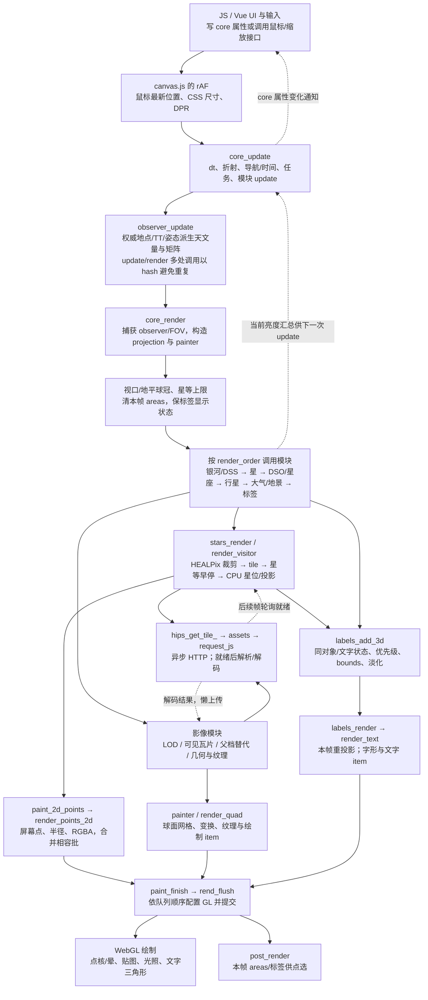

# Stellarium 源码架构、渲染与性能：对 Starward 云观星的方法迁移评估

研究日期：2026-10-14（Asia/Shanghai）。本次是研究交付，以下建议没有成为实施决定或第二份 PLAN。

## 结论先读

**值得借鉴的是怎样减少进入下一阶段的工作，以及怎样使计算、资源和呈现具有正确的寿命；现有证据不支持更换引擎或全面重构 Starward。**

- Starward 已具备公共时刻/相机、同帧拾取与来源、按需 SAO 分区、提前星等筛选、星点批绘、GPU 纹理身份复用和资源退休。普通名称/图片还增加了成功呈现后提交的进度。这些不是本研究提出的新能力。
- 最有价值的增量候选是**桌面版的“后台准备 → 主线程按帧预算上传 → 已上传即复用”分工**。Starward 可以研究其中的准备/上传调度方法，不需要复制 Qt、WASM 或巡天引擎。但现有一次长尾主要落在单次上传后的同步错误检查；预算只能减少多项工作叠加，不能保证消除一次不可分割操作的停顿。
- 其次是继续按寿命拆分星座静态拓扑、当前时刻几何、当前相机投影，并补齐跨名称族/图层的同帧呈现。我们已经完成相当一部分；剩余建议应在原 owner 内进行，先量未复用部分，不能再次从零建设缓存。
- “十亿星库”是远端数据覆盖能力。公开 Web 路径真正逐帧处理的是经空间/星等裁剪、已经到达的瓦片与其中可见恒星。它没有证明十亿恒星同时加载或同帧绘制。
- 固定公开 Web 源码**不是性能设计的全部正面范本**：普通恒星在 CPU 转换/投影；Web 默认 worker 同步执行；普通点批每次生成/删除 VBO；标签碰撞为线性遍历；HiPS 瓦片 fade 接口未接出实际渐显。不能把名称、注释或官网观感当作这些能力已经实现。

## 1. 身份、资料和证据范围

| 对象 | 本次固定身份 | 可以据此判断什么 |
| --- | --- | --- |
| 公开 Web Engine | `7d45c8fec393fbbabadcefa935794290fc39723d`，本次 GitHub API 的 master HEAD；2026-10-13 14:49:52 UTC（22:49:52 UTC+8）；提交为 frontend 依赖更新 | 本报告 W 类证据均针对这个源码版本；不能称为线上 libswe 1.17.0 的源代码。[固定提交][W-version] |
| 桌面 Stellarium | `8e3062e220808537936e492b108dabaed0c3faa4`，2026-10-13 15:29:45 UTC（23:29:45 UTC+8） | 只对照已保存的核心、星表、绘制、纹理、HiPS 和调度文件，没有审计全部桌面插件。[固定提交][D-version] |
| 官网实际部署 | 既有 2026-10-14 浏览器回执记录 frontend 1.16.0 / libswe 1.17.0 | 复用旧观察的限定事实；本次没有重新运行官网，也没有建立其完整源码、编译配置和数据发布身份。见[既有研究](stellarium-reference-research-2026-10-14.md)。 |
| 商业移动版 | [Stellarium Labs 官方产品页][Mobile]；没有可对应的移动版源码/构建身份 | 未审其渲染、线程、缓存或性能。不能将桌面 C++、公开 C/WASM 或在线版本的机制归给商业移动版。 |
| Starward | 指定工作区、`codex/remote-main-20260908`；研究起点 HEAD `b73523f1c76bf50a3811fcff65f3e2d2f791373d`，大量未提交成果 | HEAD 不代表当前源码内容。映射绑定 output 中 51 份文件的 SHA256 快照，不能用 Git HEAD 或 r71 手机包替代这个快照。 |

版本元数据、相关提交和源码清单保存在[研究材料目录][R-output]。公开 Web 的 `core.c` / `hips.c` 最近一次路径提交是 2022-09-05 的版权更新，前两次核心提交在 2021 年；仓库 HEAD 在 2026 年更新不表示这些机制也在 2026 年更新。[路径历史][R-history] 因而既有文档和在线 UI 只能作为导航，重要机制以下面实际函数为准。

证据标记统一如下：**S**＝固定源码证实；**O**＝已有实际运行观察，保原构建/输入范围；**P**＝本次隔离源码执行，非产品运行；**I**＝从已证机制作出的推断；**U**＝尚未验证。源码能证实控制流和表示方式，不能单独证实运行收益。

已恢复 AGENTS、global、Context manifest、架构/性能/资源与 Sky 产品 owners，以及现有 INDEX、CONTINUE、REQUIREMENTS、PLAN 和既有 Stellarium 研究。当前用户的“只研究”范围覆盖交接文件中以前的实施指令；没有执行 NEXT-CHAT-PROMPT 的产品命令。未改生产代码、PLAN 或 durable Context，未构建/预览/发布 Starward，未下载巡天图库、加工图片或扩大采用。

工作区正在并行开发，用户已确认。开始指纹到快照之间有 7 个生产文件发生变化；这些变化保原、不回滚。本报告区分旧 r70–r72 的证据与快照中的新增 IR 接线。快照和漂移记录见[文件清单][S-manifest]、[漂移记录][R-drift]。这份研究不会认证并行开发的结果。

交付前再读当前 CONTINUE，并核对快照到 live 的相关变化：开发线程已报告 r73 IR 的有界软件/Scene/GPU结果，又完善 publication-resource 退休、粗档来源事实和完整frame比较，并把旧 `deep-sky-image-request` 退出到纯frame类型 owner。随后 renderer/ready 的 mesh 接口也发生漂移，均保留在最终差异回执中。本报告的主表保留固定快照，沿已有结果识别“已有实现”，不把较早交接的“IR decode即退休”继续当现状，也不重跑该线程的验证。所选IR/late HTTP的原生结果、mesh消费者的最新状态、完整性能与当前候选仍看该线程证据，不能由本研究代证。

## 2. 一条真实的一帧路径

先追官方 JS wrapper 的连续帧，再沿一个可见恒星瓦片一直追到 `glDrawArrays`。网络未到时，路径返回 pending 并在后续帧继续，不是当前帧等待网络完成。

上图是公开 Web 源码调用关系，不是 GPU 完成时间线。**HiPS 下载异步；默认 Web 解析/解码及 GL 上传仍可在主线程调用路径内发生。** 支撑调用链：[canvas.js][W-canvas] → [core_update/core_render][W-core] → [stars_render/render_visitor][W-stars-render] → [painter][W-painter] → [render_points_2d/item_points_render/rend_flush][W-render]，资源分支见 [hips_get_tile_][W-hips-load]、[request_js][W-request]。

### 模块分工与权威状态

| 责任 | 真实 owner / 函数 | 权威与派生关系 |
| --- | --- | --- |
| 对象、模块和外部 API | `obj_t` / `obj_klass_t`、`module.c`、`src/js/obj.js` | C 结构前部嵌入 obj、方法表、属性和引用计数；是一棵对象/模块层级，不宜笼统称为 ECS。[对象实现][W-obj] |
| 地点/时刻/姿态 | `core->observer`，`observer_update`；`navigation.c` | longitude/latitude/elevation、TT、yaw/pitch/roll、mount 是计算输入；UTC/UT1、Earth/Sun 状态和坐标矩阵派生。UTC/TT 的属性 setter 相互同步，不存在两套独立天空时间。[observer][W-observer] |
| 相机/投影与显示参数 | `core->fov`、projection class、telescope、tonemapper | 投影在每次 render 初始化；telescope/眼适应影响星点显示阈值，属于显示模型，不是星表观测量。[投影][W-projection]、[外观阈值][W-magnitude] |
| 目录与身份 | `stars` / `dsos` modules，survey、tile 的 source objects | 数据常驻于已加载 tile；选择对象的强引用可阻止对应 tile 淘汰。每次绘制再派生可见集合。[tile 解析/寿命][W-stars-parse] |
| 资源 | `assets` → `request_js`；`hips` → `cache` → `texture` | URL 编码响应、解析 tile、CPU 像素、GPU texture 不是同一层。绘制 item 引用 texture 至 flush 结束。[assets][W-assets]、[cache][W-cache]、[texture][W-texture] |
| 场景与 GPU 队列 | module render → painter → renderer item | `painter` 携带同一个 observer/projection/clip/display 参数；CPU 准备不同 primitive，renderer 维持必要的图层顺序再批绘。[painter][W-painter]、[renderer][W-render] |
| 名称/点选/UI | labels、areas、core selection/lock，Vue/Vuex 镜像 | label 和 point area 使用本帧投影；`core_get_obj_at` 先查 label bounds 再查 area。Vuex 由 engine 属性通知更新，界面写 `$stel`，不是用 Vuex 另算一套天空。[点选][W-picking]、[UI 镜像][W-ui] |

`core_render` 的前后 observer/FOV assertions 表明“不在绘制中改变本帧时间和相机”的意图；release 构建不能把 assertions 当运行验收。areas 在队列准备时就填充，公开代码没有 Starward 的“native copy 成功后才发布 accepted-frame”事务。因此**共用几何输入 ≠ 已证实 DOM UI、GPU 完成和点选物理同帧**。

### 哪些变化使什么失效

| 变化 | 公开 Web 重新处理的责任 | 应保留的资源 / 限制 |
| --- | --- | --- |
| 固定时刻拖动 | observer 完整 hash 变化，fast 路径主要更新视图矩阵；重做视口球冠、可见 tile 遍历、每星 apparent/投影、名称重投影 | 星表 tile、source position/velocity、GPU 影像 texture 可复用；不代表每星星位计算也被缓存。 |
| 缩放/FOV | projection、telescope/显示半径阈值、星表遍历深度、影像 LOD/细分、名称星等资格 | 无须使同版本源图或星表文件失效；进出视野和换 LOD 可能带来下载/解码/上传。 |
| 改时间/播放 | observer fast/full、每星自行/视差、apparent 变换、行星位置/光照、显示环境、选择跟踪 | 静态目录、固定巡天/星座图片、地景源仍是同资源。恒星/行星/标签的坐标必须使用当前时刻。 |
| 改地点/高度/折射条件 | partial hash 变化，触发完整 observer 更新；可见地平/亮度与相机关系重算 | 天区照片内容不变；地景实例切换有独立状态。不能复用旧地点的水平坐标。 |
| 到达一项资源 | assets/worker/texture 状态推进；本帧或后续帧采样该内容 | 主线程准备与上传仍要付成本；未到时用父档，不把网络成功当显示成功。 |

`observer_update` 检查已更新 hash 防止同帧多 caller 重算完整天文量；fast 状态在 partial hash 改变或距上次 accurate update ≥1.001 天时转 full。[源码][W-observer] fast 路径用速度传播部分 Earth 状态，并更新地球自转/观察者位置与视图矩阵。行星另有 `update_delta_s` 的短时传播和 observer-hash PVO 复用。[行星][W-planets] **这些时间窗有其模型取舍，不能直接换成 Starward 的精度承诺，也不能复制简单 XOR hash 作为信任校验。**

## 3. 大量恒星和空间数据

### Web 的真实筛选链（S）

1. `stars_add_data_source` 读 survey properties，取得 min/max vmag、最低 order；亮星 survey 预取 12 个根瓦片。多 survey 用最低星等协调，Gaia 避免重复亮星段。它不是把全库一次载入。[入口][W-stars-source]
2. HEALPix NESTED 层级有 12 个根，每个父节点 4 个子节点。遍历前用 `painter_is_healpix_clipped` 排除不相交天区；更细层先有父 tile，children mask/404 可阻止继续请求不存在的子树。[遍历/资源][W-hips-load]、[球冠裁剪][W-clip]
3. `.eph` 是 EPHE chunk/table 格式：表头记录列类型、单位、行尺寸，压缩块经 zlib 解压，必要时字节转置还原；读取后构造 C 星对象、预计算位置/速度和 illuminance，再按 vmag 排序。[格式][W-eph]、[解析][W-stars-parse] 它减少传输/存储与访问成本，却不是直接在压缩数据上绘制，也不是零拷贝：request、loader 的压缩副本、解压表和 source objects 可在转换期间共存。
4. `render_visitor` 先判断 tile.mag_min；逐星遇到 vmag 超过 limit 即 break，只有 tile.mag_max 已落入当前阈值才进入更深层。renderer 累积绘制已到达的父/子星数据，要求发布层协调身份，不能按图片 LOD 互相替代来理解。`stars_limit_mag` 由最小可画点半径反解，并受 `hard_limit_mag` 限制。[实际循环][W-stars-render]、[显示阈值][W-magnitude]
5. 通过星等的星在 CPU 执行 proper-motion/视差、frame conversion 和投影；离屏点早退。同一 vmag 相邻星复用半径/luminance，B−V 颜色仍在循环算。普通 Gaia 星不自动加名称；较亮、具备显示条件的点才进入 areas。[实际循环][W-stars-render]

公开 Web 没有在这条路径里实施通用“屏幕每格最多 N 星”的硬密度 cap；主要是视场→望远镜/眼适应→点半径/星等→空间剔除。硬缓冲边界另属 renderer，不是目录深度。`render_points_2d` 每 item 容量 4096，输入一次超过 4096 时直接截到该数并记错；不能把这个写成任意大 tile 自动拆批或全库无上限绘制。[renderer][W-render]

### 时间、变换和重复工作（S/I）

`compute_pv` 在 tile 解析时把原始 astrometry 化为 position/velocity，归到 2000 历元。其无有效 parallax 时忽略 proper motion 的处理是明确源码限制；不能照抄为本项目科学规则。逐帧 `star_get_astrom` 传播自行并扣 Earth position，然后 `frames.c` 应用光偏折/光行差、岁差章动、地球自转/地平转换与可选折射，最后 CPU 投影。[星位准备][W-star-motion]、[坐标变换][W-frames]

共享 observer 矩阵减少重复的全局计算，但不等于每颗星的完整 apparent transform 只算一次。3D labels 在 label 阶段重新投影，和星点几何存在重复；这体现选择了简单统一接口，也仍有 CPU 成本。Starward 已经保留当前精确时刻的水平位置，BSC 的显示方向/透射懒准备，固定时刻拖动主要用点积；**不能因 Stellarium 用 WASM 再建议我们重复做这项已完成优化**。[本地星帧][S-stellar]、[本地 supplement][S-supplement]、[投影][S-projector]

### 桌面版对照（S）

桌面星表使用二十面体 geodesic grid（每层 `20×4^level` 区域），不是 Web 星表的 HEALPix 运输树。`StarMgr::draw` 查询 inside/border zones；完全内部的区域可以省逐星 screen-cap 检查，边界区域仍逐星裁剪。不同等级用 Star1/2/3 紧凑结构，固定版本分别为 48/32/16 bytes；`ZoneArray` 可用 QFile map，或读入内存，并按星等早停。星点半径/亮度用每层 RCMag 表（0.05 mag 步进）复用。[StarMgr][D-stars]、[ZoneArray][D-zones]、[记录尺寸][D-star-record]、[区域索引][D-grid]

这支持“紧凑表示、内外区域分类、先资格后星位”的方法价值。它不支持“微信也可以 mmap 整库”或“换成 geodesic 就必然更快”：内存映射依赖本地 OS 文件/分页，区域测试必须保高自行、折射边界和广角投影的保守性；星等量化表也不是我们当前连续外观公式的等价替换。

### 三种数量必须分别记录

| 数量 | Stellarium 本次掌握情况 | Starward 本次掌握情况 |
| --- | --- | --- |
| 全库身份/覆盖 | README 声称可访问 >10 亿 Gaia，未读取整库 count/完整供给；不作实测规模 | BSC v3 manifest 声明 8,404 行；SAO v2 publication 为去重补充 246,280 行，总身份 254,684。SAO 826 tiles、35,314,828 encoded bytes；不是完整至 10 等的保证。[BSC][S-bsc]、[SAO][S-sao-publication] |
| 当前已加载 | 公共 cache 中 source 数要另外计数；stars progressbar 的 nb_loaded/nb_tot 是 tile 状态数，非星数 | BSC 发布数据与当前 SAO wanted/loaded 行数分别计；旧 r69 样本 SAO 工作量为 0，不能说手机加载 254,684 星。 |
| 本帧已绘 | 应统计各 stars paint batch 的 n 和实际 GL submit，不能用已加载或 tile progress 代替；本次未运行统计 | r69 catalogEligible max179/mean172.33 是准入计数，含义不同于成功呈现的 GL 点数。完整可见身份应由 accepted receipt 与实际 submit 读回。 |

本轮只核本地 publication/index 的声明和源码，没有把全部 tile 重验包装为运行验收。当前候选和实际供给资格仍由原任务维护。

## 4. GPU、透明合成和文字

### 恒星并不依靠逐星 draw call（S）

Web 普通星用 `GL_POINTS`。`POINTS_BUF` 16 bytes/顶点：float2 屏幕 NDC、float 半径、归一化 UBYTE4 颜色；`get_item` 尝试与相容的相邻 item 合并，只有显式允许重排才向更早 item 查找。因此同时控制了 draw-call 数和透明/图层顺序，不是无条件把全场按材质排序。[批结构/队列][W-render]

普通星已在 CPU 投到屏幕；vertex shader 写 gl_Position/gl_PointSize，fragment shader 用 gl_PointCoord 算软核与弱晕。2D 星不在 shader 算自行或天文变换。另有 IS_3D 点和图片/行星 shader 的投影、法线/光照路径，不应据此概括“所有星的投影在 GPU”。点层采用 `SRC_ALPHA, ONE` 的加法混合。[点 shader][W-points]、[GL 提交][W-render]

**限制也很明确**：Web `item_points_render` 每个批次 `glGenBuffers → glBufferData → glDrawArrays → glDeleteBuffers`；flush 后释放 CPU item/buffer。C/WASM 减少 JS 对象 GC 不等于消除了分配/上传。桌面版则在预分配的 vertex arrays/VBO 中写 6 顶点星 sprite，并统一提交，还可能为亮星另画大 halo。[桌面点绘制][D-point] Starward 已保 renderer lifetime 的 program/buffer，按点/线相容序列批绘；当前 9 float/点包含本项目 shape 信息，不能不保语义地直接套 16-byte 布局。[本地 GPU][S-gpu]

星点和透明图像的成本还取决于**片元覆盖**：晕变大、多层加法和高 DPR 会增加 overdraw，draw call 少并不意味着便宜。相同逻辑面积随 DPR² 增长是像素工作量的推断，不是实测 GPU 时间。Web halo=7、max radius=50 的显示配置不能拿来当手机最佳值；Starward 的实际 point-size hardware clamp 已存在。[点尺寸][S-gpu-point]

Web 影像走球面网格/纹理三角形，grid 只对无限远 HEALPix 坐标缓存，仍逐帧作观察者/投影转换；全 RGB 且全不透明的普通贴图禁用 blend，其它普通图 source-over，指定 ADD 层加法。大气在较粗网格上 CPU 采亮度再由 shader 插值/计算色度，体现“减少模型采样数，接受插值误差”的取舍，不能直接证明我们全屏逆射线 shader 应改成它。[网格][W-grid]、[贴图 pass][W-texture-pass]、[大气][W-atmosphere]

### 文字有三个不同层次（S）

| 层次 | 公开 Web 实际做法 | 成本与边界 |
| --- | --- | --- |
| 内容/准入 | star_render_name 按星等选择文化名/Bayer 的长短形式，选择对象用 bold 与高优先级；自动标签用 `-vmag` | 名称不等于全部可见恒星。缩写/16字符换行是它的产品策略，不适合复制到我们“完整名称”的合同。[名称入口][W-star-label] |
| 布局/显示状态 | `label_get(obj,text,size)` 保对象身份与 fader；每帧重投影、测 bounds；TEXT_FLOAT 逐个比较不低于自身优先级的 label，超过8px交叠则退场；遮挡再抑制；点击查当前 bounds | 近似 O(L²)，不是空间索引或全局最优排版。排序是距离，优先级用于碰撞判断，并非简单“全列表按优先级排序”。存在淡化稳定性，但没有 Starward 当前保 accepted side 的完整左右避让策略。[labels][W-labels] |
| 字形与绘制 | 默认无 sys render_text callback 时用 NanoVG/Fontstash 的栅格字形 atlas；脏区才更新字形纹理。每个 ITEM_TEXT 分别 nvgBeginFrame/EndFrame。若平台注册 render_text callback，改走整串 RGBA texture cache | atlas≠SDF/MSDF，也不保证全部名称只有一次 draw。平台 callback 分支不是默认浏览器路径；整串 cache 的 in_use 标记不能证明已接好有界淘汰。[文字分派][W-text]、[atlas][W-nanovg] |

桌面 `StelPainter::getTextTexture` 按文字、字号、font key 缓存整串 texture，用 QFontMetrics/QPainter 栅格化，QCache 有 cost 淘汰（此版 limit 为7,000,000的逻辑成本）。它与 Web 默认字形 atlas 是两种实现，不能合成一句“Stellarium 统一文字图集”。[桌面文字][D-text]

Starward 普通目录名称已经来自 Canvas2D 的完整字宽与同次 surface copy，并以同份 bounds 点选；`sky-name-layout` 保 accepted side、有限名称数、边缘/碰撞退场和首成功呈现后的进度。装饰星座字仍按字距逐 glyph 测绘，选中/方向/完整星座族的联动还有未闭范围。[名称布局][S-names]、[共同资格][S-labels]、[surface][S-surface] 因此优先完成原布局/同帧 owner 的实际消费者，而不是新建全场 GPU 字体引擎。字宽复用或 atlas 只在实际文字负载成为热点后再评估；当前装饰 slice 旧样本没有显示其同步调用成本占主导。

### 高 DPR 的一个反例（S/P）

公开 `canvas.js` 比较 `canvas.width !== CSS width`，却设置 `canvas.width=CSS width×DPR`，height 同理。稳定 DPR>1 时下一帧仍满足 sizeChanged；CSS 为小数时整数 backing size 也会持续不相等。[源码][W-canvas]

本次只做一项有界源码执行：在隔离 VM 中执行这个未修改 wrapper，stub DOM/engine，分别跑三个 render callbacks。800×600/DPR1 赋尺寸1次，DPR2与3均3次；800.25×600.25/DPR1也3次。见[原始结果][R-probe]、[脚本][R-probe-script]。**它证实赋值判断，不是实际浏览器重分配耗时、线上缺陷或微信性能实验。** 这也说明公开 wrapper 的 resize 逻辑不能直接搬入我们按实际 backing size 校验、仅生命周期重建的 surface。[本地 surface][S-surface]

## 5. 影像 LOD、加载和内存寿命

### 图层协调（S）

Web render_order 的明确值：银河5、DSS6、stars20、DSO/constellations25、planets30、atmosphere35、landscape40、labels100。相同 order 不是这些模块内部依赖已被全部规定。[core 排序][W-core] 各图层都接受同 painter：

- 银河和 DSS 在10–20° core FOV 之间用互补的尺度曲线切换，亮度又受 tonemapper/望远镜/Bortle 等调制。它是不同来源背景的视觉协调，不是同源 fine/coarse 的严格单次混合保证。[银河][W-milkyway]、[DSS][W-dss]
- 星座插画由真实锚星构造 UV→ICRF 平面、球冠 cull、随视场淡化；`image_loaded_fader` 在 texture 可用且视口相交后激活，1秒加载渐显确实接通。星座形状约一年内复用，但绘制仍用当前 observer 转换；这个近似时间窗不适合直接降低我们的时刻精度。[星座][W-constellations]
- 普通天区图片没有“每个 DSO 必定自带独立高清纹理”的通用保证；Web DSO catalogue 标记/名称与 DSS 背景是独立责任。行星则有专门球面 tile/normalmap、光照和粗色 fallback；地景在 FRAME_OBSERVED，用太阳/月亮的亮度和视场/视线调透明度。照片、行星纹理、地景不是可以统一抹平含义的一类。[DSO][W-dso]、[行星][W-planets]、[地景][W-landscape]

不研究 DSS 色块的加工历史，不引入人工云层。上述摄影层只用于理解职责与资源策略。

### Web 图片 tile 的成功/未到路径（S）

`hips_get_render_order` 将投影中心角尺度、逻辑屏高与 tile pixel width 匹配，结果四舍五入；`hips_render` 再夹到 survey 范围且最大 order9。**此 Web 公式用 logical window height，没有显式乘 pixel_scale/DPR**；星点使用 DPR 不代表影像 LOD 同样按物理像素选择。DSS 另根据极区距离增加网格 split，但限制到 render_order+3。这是在弯曲失真/细分量之间的启发式取舍，不是严密的每像素误差界。[LOD][W-hips-lod]、[DSS split][W-dss]

图片 texture 获取顺序为：该 tile → 父 tile 的相应 UV 象限 → 适用的 order0 Allsky → 无可用图。父档只替代当前子区域的采样，不整幅重画父图再叠子图，减少双亮/重复覆盖；父档本身缺失时仍可能空白。Allsky 不是所有 survey 都可用，源码对最低 order 和版本有条件。[fallback][W-hips-texture]

**重要订正**：这个固定版本 `hips_get_tile_texture` 将 `fade` 初始化为1，成功 tile 直接返回；tile 结构虽有 fader，却没有驱动其 fade 输出。因此它证实保父档与单一替代采样，**没有证实通用的细 tile 就绪渐显**。星座图的 loaded fader、图层 visible fader、label fader 是另外的真实路径，不能互相代证。官网此项是否不同为 U。

同源替代还不能保证接缝消失：tile 图内背景差异不由运输网格解决；CLAMP/LINEAR、投影几何、有效 alpha、父/子采样精度仍影响边缘。Starward 必须继续按已采用输入的接缝/coverage owner 处理，不能照搬消黑或“全父图+全子图加法”。

### 网络、解码、CPU、GPU 分别归谁（S）

| 阶段 | Web 的真实机制 | 性能代价/未接通处 |
| --- | --- | --- |
| 网络需求与响应 | assets 按 URL 找 request；request_js 最多16项，Emscripten async wget 回调；删除 active request 时可 abort | 16是它的配置，不能突破微信/我们现有预算；Web request_init 忽略磁盘 cache_dir，浏览器 HTTP cache 与本地 libcurl 磁盘缓存不是一件事。[request][W-request] |
| 细档启动 | parent-first、不存在子节点标记；ASSET_DELAY 初值60，每次访问递减 | 是访问次数，不是墙钟定时器；多 caller/FPS 会改变等待，不能称“严格1秒 debounce”。assets 对一般 unused item 的删除仍有 TODO。[assets][W-assets] |
| 解析/解码 | tile loader 复制 encoded bytes、release asset，再 create_tile；图像使用 img_read_from_mem | 默认 Web `worker_iter` 同步调用 fn；没有 Web pthread flag/实现来支持此路径后台执行。网络 async 不等于 CPU async。[worker][W-worker]、[build flags][W-build] |
| GPU 创建 | 第一次取 drawable tile texture 时 texture_from_data/glTexImage2D；之后保 texture handle；通常上传后 free(tile.img) | 新 tile 到达仍可在 render 内上传；无本路径的当帧上传时间预算。非2幂图被补到下一2幂，临时像素与 texture 放大需计量。[texture][W-texture] |
| tile cache / 淘汰 | 全局256MiB成本目标；LRU式 touch 顺序、1秒 grace，delete callback 可 CACHE_KEEP；选择星引用和在途 loader 可阻止删 | 不是整应用/物理GPU硬上限。cost 不覆盖所有字符串、loader副本、Allsky、drawing buffers和驱动；压力下不等于立即释放所有内存。[cache][W-cache]、[hips][W-hips-load] |
| 绘制队列退休 | item retain texture，flush 结束 release；texture ref为0才delete GL texture | 保当前提交对象，是避免提前删除的真实设计；不认证驱动立即回收。[队列][W-render]、[纹理引用][W-texture] |

公开 `delete_img_tile` 没有释放尚未上传的 tile.img，`hips_delete` 也没有在该函数中释放 Allsky.data；这是阅读到的释放缺口，未运行泄漏复现。不能将这套 cache 称为完善的内存生命周期方案。WASM `ALLOW_MEMORY_GROWTH` 只允许线性内存增长，不证明峰值受控或向 OS 归还容量。[hips][W-hips-load]、[build][W-build]

### 桌面版真正增加的能力（S/I）

`StelTexture::startAsyncLoader` 将读图/转换放到 QtConcurrent 的专用 pool；texture `bind` 轮询 loader.isFinished，准备完成后仍在有 GL context 的主线程 glLoad。manager 汇总本帧 glLoad 墙钟并在 frameFinished 清零。超过 `max(1秒/(2×desiredFPS), 1秒/120)` 后，本次 bind 返回 false，等待以后帧；已上传的 texture 直接 bind。[texture][D-texture]、[manager][D-texture-mgr]

这是**软预算**：检查发生在下一项开始之前，一次大上传仍可能超时；它不是异步 GPU 上传完成保证。pool 在 x86_64 用 idealThreadCount，其它架构限制为1，以减少并行大图的内存峰。将图片并行准备与 GL 串行提交分开值得研究，数值与线程数不应原样迁移。

桌面 `HipsSurvey::dropUnfinishedInvisibleTiles` 移除离开视野且仍加载的 tile，避免它们挡住现在可见的任务；相关[提交1cfb3c8][D-cancel-commit]明确说明动机。其 HTTP/1.1 选择还与 Qt并发、服务端 HTTP/2取消策略有关，不是普遍“禁用HTTP/2更快”。Starward SAO loader、native image queue 已取消过期需求并在真实 settlement 前保并发槽，属于已有能力。[SAO loader][S-tile-loader]、[native loader][S-image-loader]

Starward 已将 encoded file lease、decode/Canvas lifetime、GPU texture 和 accepted presentation 分开：encoded 总32MiB、单文件16MiB、在途 encoded I/O 总16MiB；native image queue 通常2项、默认16MiB旧视图保留压力（各家族可更窄）；GPU16MiB是压力目标，当前真正工作集可超过它；SAO view6MiB/3请求是另一责任。[公共文件][S-public-runtime]、[native][S-image-loader]、[GPU][S-textures]、[SAO][S-tile-loader] 本研究不增加这些预算，也不把它们相加称为物理内存上限。

## 6. 渲染循环、交互和长帧

公开 Web wrapper 持续 rAF，固定 time_speed=0 也没有 dirty-only 绘制判断。桌面用 QTimer、updateQueued 合并一次 update，事件后2.5秒或快于1x时间播放时取 maxFPS，否则回 minFPS；实际 min/max可配置，不保证闲时一定省电。macOS 分支保最小 frame-end 到 next-start 间隔以处理事件/绘制队列争用。[Web loop][W-canvas]、[桌面 loop][D-loop]、[官方问题2778][D-input-issue]

这条桌面问题的可迁移认识是“帧率数字、输入年龄和交互响应可能不同”，不是恢复某个固定 throttle。Starward 当前已有 latest frame+一个在途、visibility/generation栅栏、pose合并、成功 copy 后 commit、仅相机/文字/图片还有动画才续约16ms timer。**setTimeout 合并不是已证 vsync**；但旧 r27 同构建 timer/RAF 对照没有收益，不能仅因 Stellarium 用 rAF 就重做那条已拒绝路线。[lifecycle][S-lifecycle]、[page commit][S-page]、[旧对照](drag-performance-2026-10-13.md#r27对照结果不采用raf)

连续时间的参考价值是所有图层读取同一 observer，固定图片身份不随时间清空，而坐标/环境更新。Starward 已有 observation-time 意图、BFF Astronomy Engine 几何、受覆盖约束的本地 timeModel 插值和精确帧绑定；不能再建议“新增统一时间”或另建一套浏览器天文内核。[公共时间][S-time]、[time presentation][S-time-presentation]、[time model][S-time-model]

公开 C/WASM 将大量循环放在 C，不代表零分配、自动多线程或自动按帧让出。core task loop 没有普遍 job deadline，tile decode、per-tile points malloc/free、renderer item/VBO 创建以及字形冷准备仍可能形成长帧。官网流畅可能还来自不同数据、缓存、编译版本、GPU/分辨率和更快CPU；本次未测因果，不能作为微信收益依据。

## 7. 性能方法：问题 → 做法 → 证据 → 收益/代价

以下收益均为机制解释（I），除标 O 的旧 Starward 观察外，没有本次微信收益测量。

| 问题 | Stellarium 做法与固定证据 | 节省什么 | 增加什么/何时有效 |
| --- | --- | --- | --- |
| 同帧反复取天文量 | observer full/partial hash，fast/full分路；planet PVO/短时传播。[W-observer][W-observer]、[W-planets][W-planets] | 全局历算重复、短时完整轨道求解 | 近似误差和正确失效责任；不能直接沿用1天/各planet阈值。 |
| 全库扫描/下载 | 空间树+球冠裁剪+星等分层+有序星早停。[W-stars-render][W-stars-render]、[D-stars][D-stars] | 不相交区域、过暗行、无用请求 | 边界、岁差/自行/折射扩大 bounds；广角涵盖很多区域时收益变小。 |
| 星表体积/解析 | EPHE typed columns、byte shuffle/zlib；桌面记录分级和mmap。[W-eph][W-eph]、[D-star-record][D-star-record] | 编码大小、对象表示成本 | 解压/转换峰、版本/验证/分发迁移；mmap依赖桌面；不是暖拖动的直接解法。 |
| 外观公式重复 | Web同vmag相邻复用，桌面RCMag表。[W-stars-render][W-stars-render]、[D-stars][D-stars] | 重复半径/亮度变换 | 查表/缓存成本、量化误差；只有appearance已测热点才值得扩大。 |
| 逐星提交 | Web GL_POINTS紧凑批；桌面sprite批。[W-render][W-render]、[D-point][D-point] | GL调用和顶点带宽 | 点尺寸硬件限制、透明顺序、halo填充；Web每批VBO重建不是优势。 |
| 静态球面几何重复 | Web缓存无限远HEALPix grid，星座长期复用ICRF形状。[W-grid][W-grid]、[W-constellations][W-constellations] | UV→球面与稳定拓扑计算 | 缓存成本、不同细分键、仍需当前时刻/投影；不能缓存屏幕位置冒当前帧。 |
| 图片未到/换档空白 | parent-first、child UV采父图、Allsky条件fallback。[W-hips-texture][W-hips-texture]、[D-hips][D-hips] | 粗图重复绘制，保可用背景 | 父档驻留、真缺测处理；公开Web未证tile渐显。 |
| 到达后突变 | 星座loaded fader，labels持久fader。[W-constellations][W-constellations]、[W-labels][W-labels] | 降低视觉突跳 | 动画续帧与显示状态；适用的纹理/当前资格要有效，不授科学有效性。 |
| 重复GPU上传 | tile/texture保handle，draw item强引用至flush。[W-texture][W-texture]、[W-render][W-render] | 同资源再decode/upload | 工作集内存；弱/强引用和淘汰职责，256MiB不能照搬。 |
| 多图准备集中堵帧 | 桌面后台loader+当帧累计上传软预算。[D-texture][D-texture]、[D-texture-mgr][D-texture-mgr] | 主线程解码、多个upload同帧叠加 | 就绪等待/粗档寿命、decoded峰；一次大upload不可被预算切开。 |
| 过期资源堵当前需求 | 桌面HiPS删unfinished invisible；Web async请求限流。[D-cancel-commit][D-cancel-commit]、[W-request][W-request] | 当前可见内容的排队延迟 | 取消后settlement/slot、重复进入的复用；不可照搬网络并发或HTTP版本选择。 |
| 字形每帧栅格化 | Web字形atlas脏区更新，桌面整串texture QCache。[W-nanovg][W-nanovg]、[D-text][D-text] | 重复字形生成/上传 | 字体供给、国际文字、atlas冷到达/内存、hit bounds一致；不解决相机/文字不同帧。 |
| 闲时资源/能耗 | 桌面事件/时间率调整目标FPS，queued update。[D-loop][D-loop] | 闲时无效绘制（取决于配置） | 低更新率下的响应延迟；Web不是按需方案，我们已有更明确生命周期。 |

## 8. 与 Starward 实际代码的映射

本表 S-* 链接指研究快照中的真实文件；生产 owner 名称不因研究改变。“已有”指代码机制，不扩大旧目标运行验收范围。

Starward 的对照路径为：公共 observation-time 意图 → 当前 `observation-frame/timeModel` → 同一个 browsing camera/projection → `sky-scene-render` 的目录、星座、图像与地景 → 原 GPU renderer → native surface 同次 copy 与完整名称 → `present` 成功后发布 accepted-frame，并 commit 文字/图片进度。网络、encoded 文件、decoded bitmap 和 GPU texture 各自保生命周期，不能由请求成功提前发布呈现。实际连接见[page][S-page]、[Scene][S-scene]、[surface][S-surface]；时间派生见[time presentation][S-time-presentation]、[frame][S-observation-frame]。

| 类别 | 方法/责任 | Starward 实际 owner 与结论 |
| --- | --- | --- |
| **我们已经具备** | 单一时刻与相机；按输入寿命复用 | `sky-observation-time`、`sky-time-presentation`、`sky-browsing-camera/sky-canvas-view`、`sky-view-projection`。不用引入core singleton重写页面状态。[时间][S-time]、[浏览相机][S-camera]、[视图][S-view] |
| 已具备 | 星表静态与当前时刻分开 | `sky-stellar-scene` 弱键出版模型/颜色、每scene一个当前帧、BSC显示方向/透射懒准备；`sky-stellar-supplement-scene` 每tile只保当前geometry。比Web逐帧星位循环更适合现JS交互寿命。[BSC][S-stellar]、[SAO][S-supplement] |
| 已具备 | 空间/星等筛选与有界调度 | SAO按纬圈/经段与不相交magnitude tiers发布；selector用实际caps+motion bounds+共同appearance，loader按亮度优先、3槽/6MiB、取消并保真实settlement。[publisher][S-sao-publisher]、[selector][S-tile-selection]、[loader][S-tile-loader]。不是HEALPix星表，也无需因此迁网格。 |
| 已具备 | 点/线批绘、程序化星核/晕、硬件point-size边界 | `sky-gpu-renderer`+TWGL，lifetime buffer/program；同kind批，切图层flush。shader有core/halo/wing及DPR clamp。[GPU][S-gpu] |
| 已具备 | 同帧发布与迟到栅栏 | `sky-canvas-lifecycle` latest+busy/generation；`sky-canvas-surface`同copy reticle/captions；`spot-sky-page`只在present成功后publish/commit。[lifecycle][S-lifecycle]、[surface][S-surface]、[page][S-page] |
| 已具备 | 减少无用纹理替换 | `sky-gpu-textures`相同bitmap/window命中、16MiB压力、frame pins、multi-sampler pins、failed-upload latch、finish退未used；小银河canonical full与大源exact crop已实现。[textures][S-textures]。不再建议“加缓存”或“银河保整图”作为新增项。 |
| 已具备 | 多级保粗/就绪包络/单次同源合成 | `sky-ready-presentation`、`sky-ready-artwork`、native levels、exact/legacy组合；首successful copy后起时钟，alpha0不授credit。[ready][S-ready]、[实际准备/绘制][S-ready-artwork]、[合成][S-levels]。快照中的IR也已出现retained/coarser/单次组合接线，[Hook][S-ir]和[Scene消费者][S-scene]均有对应路径，但这是并行开发输入，本研究未验证其结果，不能继续写成“仍只有decode即退休”。 |
| 已具备 | 名称侧向稳定、完整字形、当帧命中 | `sky-name-layout`保accepted side、真实glyph bounds、有限名单和呈现进度；共同label资格消费已绘点/遮挡。[names][S-names]、[labels][S-labels]。不能把Web相邻碰撞当更成熟的完整布局替换。 |
| 已具备 | 静态HiPS基面网格、真实球面三角形/LOD组 | `sky-hips-tile-mesh`的12 base tiles、当前时间/相机投影；`skyImageMeshLevels`同源PNG组组合，部分retained JPEG fallback规则。[mesh][S-hips-mesh]、[Scene][S-scene]。普通HiPS仍关，不能以源码存在称目标可用。 |
| **值得借鉴** | GPU准备与显示分阶段、每帧上传软预算 | 在原texture/renderer/ready owner研究显式deferred与下一帧续约，保实际present/credit和粗层。现prepare/paint Boolean不能把deferred当失败。详建议1。[textures][S-textures]、[ready][S-ready] |
| 值得借鉴 | 静态拓扑/UV部分与当前时刻旋转进一步分开 | `sky-constellation-scene`已有motion/current-frame memo，但新时刻仍重建line关系、唯一star集合、labels聚合与registration；`sky-constellation-render`投影细分继续按当前view。只复用可证明静态部分，不沿用“全年不更新”的近似。详建议3。[constellation frame][S-constellations] |
| 值得借鉴 | 更早限定星等候选/内部区域分类 | BSC原始发布已按Vmag排序，但Scene `forEach`仍逐行cheap reject；SAO按ID排序，不能直接break。可在已有admitted render model内派生有序索引；inside/border只在获益和保守边界都成立时采用。详建议4。[BSC][S-bsc]、[Scene][S-scene] |
| 值得借鉴 | 以屏幕需要细节选择影像LOD/细分 | `sky-hips-tile-selection`当前以预算/天区规模求order；可在原maxOrder/12-tile/权益边界内叠加投影像素尺度，避免取高于源有效细节或输出需要的档位。HiPS普通关，列为后续条件建议。[selector][S-hips-selection] |
| **依赖平台能力，须先验证** | 真正worker / WASM热循环 | 微信worker、字节搬运/取消以及WASM部署需另验；DOM、Emscripten wget、pthread/Qt pool不能直接运行于现WEAPP。先证明CPU热点值得迁移，不先移整引擎。公开Web“thread”字段并非收益证据。 |
| 平台待验 | GPU timer、文本atlas、纹理上传时序 | 看实际target是否支持非disjoint async timer；原生Canvas2D glyph与WebGL texture互操作/字体/字距需验证。不能用gl.finish或CPU调用wall补成GPU完成证据。 |
| 平台待验 | direct WebGL展示、preserveDrawingBuffer=false | Web默认直接GL且不preserve；Starward有原生合成边界，现offscreen GL→visible2D copy要求不同。不能为省一次copy直接删surface或改flag。[surface][S-surface]、[Web init][W-web-init] |
| **不适合/当前不划算** | 全套Qt/WASM/对象树替换、mmap大星库 | 改动涵盖时间、相机、星表、投影、资源、UI、平台端口和许可；没有同条件性能证据覆盖成本，也与本次研究边界不符。 |
| 不适合/不划算 | Web每批建删VBO、60访问延迟、256MiB cache目标 | 我们已有长寿命buffer、明确取消/字节owner；这些上游具体实现不应倒退采用。 |
| 不适合/不划算 | 固定rAF/多重throttle、邻域全预取、TypedArray pool | r27 RAF已拒绝；当前Float32转换旧测仅0.04–0.06ms；未证等待/GC是首要热点，不增加新状态与驻留。[旧证据](runtime-performance-2026-10-13.md) |
| 不适合/不划算 | 随机补星、量化外观替代真实观测、DSS数据/图片自动采用 | 损害identity/科学或不符已定权利；格式和视觉参考不能授具体数据权。 |

## 9. 按实际瓶颈排序的建议

这是建议序列，不是授权实施或更改唯一 PLAN。owner/模块沿[现有 PLAN](../PLAN.md#模块方案)：B＝资源编排与已绘呈现，D＝提前融合/连续背景/高DPR，E＝原生交互与页面协调，F＝发布资源与联合验收；没有新的产品任务目录。

### 先说明排序用到了什么测量

| 既有证据（O） | 本次核到的范围和结果 | 能/不能说明什么 |
| --- | --- | --- |
| r69 texture-steps；2026-10-14 00:00；SHA c6e0…13e71 | 指定Android WeChat开发反馈；截图1080×2376，logical canvas384×796.8000488，vertical FOV90°，首尾太阳−14.96146°/2026-10-13 19:00 UTC+8；暖1000ms横拖+原180ms尾段；72 frames/192 requests。TOP body19ms、artDraw14、texture12、upload后getError12；同TOP 12 hit/1 miss、1MiB upload尝试。[raw][E-r69] | 支持优先研究纹理准备/同步长尾。设备型号、实际GL framebuffer/DPR、逐帧角覆盖和GPU elapsed未绑定；不从截图/logical比例猜DPR。catalogEligible不是已绘星数，SAO0。 |
| r64→r65 galaxy；原同类短路径 | 暖90°银河调用长尾24→2ms，r65期间upload/copy为0，resident8MiB；仍art14/gap40。是顺序有界样本，非所有中间姿态精配。[raw][E-r65]、[说明](point-assembly-2026-10-13.md#银河固定采样窗与连续拖动) | 该机制已采用，不能建议重复实现或拿差值保证整场FPS。代价是完整源驻留增长，物理峰未核。 |
| r48装饰星座字；同build CAPTION/BASE | 45°约1名、90°均4.60/max5名，各3 glyph；新增glyph block mean约0.09/0.10ms、max1ms；宽视场Scene仍可35–40ms。[raw][E-label] | 装饰字同步call不是这组主导项。不是当前全部名称、字体GPU时间、物理同步/长会话证明。 |
| r13本地CPU与10分钟进程观察 | 出版附着优化已完成；本机360时刻profile；Android620秒/11数字样本RSS为1,621,984–1,676,892KiB（约1.55–1.60GiB），Graphics恒390,148KiB，含微信/预览引擎。[raw][E-memory]、[说明](runtime-performance-2026-10-13.md) | 未见该窗口持续增长，不是云观星独占内存或无泄漏证明。不能因进程大就新增GC/缓存框架。 |

r69平均/p95 accepted-copy gap14.67/26ms不是物理FPS；GL整数wall为0不表示GPU零成本。单frame内嵌套阶段不相加，独立max不能拼成同一长帧。官网与本项目没有同条件性能A/B；本次没有新增产品跑分。

**FOV比较尤其容易误判**：公开 stereographic 的 core.fov 指两轴中较小的视角，而 Starward 参数是verticalFovDeg；纵向屏幕同标90°可覆盖完全不同的天区。公开Web影像LOD又用逻辑高。比较应读实际projection、aspect、center、边/角反投影与DPR，不能只调两端显示的角度数字相等。[Web FOV定义][W-fov]、[Starward projection][S-projector]

### 建议1：原纹理owner内验证“就绪准备与显示提交分开”，优先控制资源到达长帧

**依据/收益条件**：当前纹理长尾证据最直接；桌面上传软预算提供可复核设计。可以减少多项shader/texture初次准备集中在一个交互帧的叠加。r69只有1 miss，且长尾在上传后getError，不能承诺该样本仅加预算就加速，更不能删除错误检查来制造收益。

**Owner/范围**：B/F 的 `sky-gpu-textures`、`sky-gpu-renderer`，以及 `sky-ready-artwork/presentation` 和调用其prepare端口的实际图片消费者。沿已有bitmap identity、frame pins、失败锁和单writer，不新增HTTP/cache系统或扩大驻留预算。先区分“缺数据/失败/已准备/本帧暂缓”，暂缓需能续约下一有效帧；同源旧纹理/粗图只在新档真正可绘且接替完成时退休。

**风险**：一项大上传仍阻塞；暂缓导致首图等待、decoded backlog、旧档错误退休、false被误判failure、冷返回饥饿或来源提前授信。跨图层顺序不应偷偷变为材质排序。GPU/driver内部因果仍未知，预算不能冒异步上传。

**最小验证/停止条件**：使用现有隔离Scene/renderer入口和冻结图片，比较一项晚到与同一帧多项到达两种机制；warm cache命中作counterpart。记录同资产的decode/prepare/upload尝试、同步wall、accepted-copy间隔和名义resident/临时峰；验证粗图/单次亮度/credit、失败、hide取消。只在目标Android可用时做同build有限对照；无法区分或没有交互收益则保原，不扩队列或改预算。这是未来验证建议，本次没有实现/运行。

### 建议2：完成当前名称/图片连续性消费者，保持accepted-frame语义

**依据/收益条件**：公开label/插画fader证实持久显示状态有助于视觉连续；Starward同copy与ready owner更符合本平台。收益首先是消除文字相对天空滞后、晚到突变/换档空闪，而不是声称降低全部CPU时间。

**Owner/范围**：E 的 `sky-label-presentation`、`sky-name-layout`、`sky-constellation-labels`、`sky-canvas-surface`、page受接受的selection/target guide；B 的原ready/level composition消费者。沿当前完整名称、当前框命中与地景mask；不要再开装饰文字renderer。IR已有实现及r73有界结果，沿最新证据补仍需要的验收，不重复实施。HiPS仍是条件消费者。

**风险**：只同步可见文字却留下旧点击框；换侧反复重启进度；旧scene/时刻接受新标签；把来源/有效黑与显示透明度混合；对比跨源误作同源mix。

**最小验证/停止条件**：复用原普通目录同copy/名称与r70–r72仍适用证据。只取完整名称靠边/跨层遮挡、显式选中与自动退场、晚到fine/更粗回替的机制代表；检查真实输出与同一accepted bounds，不重跑未变全矩阵。无GPU文字热点证据前停止于现有Canvas2D路径。

### 建议3：精确时间变化时，复用星座静态拓扑和UV常量，保留当前坐标

**依据/收益条件**：Web将ICRF形状/图像矩阵与相机变换分开；我们的motions/current-frame已复用，但每新时刻仍构造line关系、HIP集合、聚合标签与注册数据。旧本地换时刻profile星座约0.91ms，只支持局部候选，不能视为当前连续时间全部问题的根因。

**Owner/范围**：B/D 的 `sky-constellation-scene`及registration责任；继续使用原Scene、Astronomy Engine派生旋转和投影，不另建静态天空。静态索引/anchor UV只按出版身份准备一次；自行、当前ENU方向、太阳/地景环境和球冠有效边界按原规则更新。必要复用通过原同一frame供render/labels/demand。

**风险**：照抄365天阈值丢高自行/时刻正确性；不归一化权重混入独立归一化射线；scene替换使派生缓存失效；预烘整日造成冷准备和内存增长。

**最小验证/停止条件**：先用原本地profile观察稳定出版下换时刻的具体子项；冷构造、固定时刻drag、新时刻各分开。以原结果的lines、anchors/UV、labels/需求和非空Scene比对，随后只核受影响连续时间显示。若静态部分不是显著成本或复用会增加复杂性，停止，不改变精度窗或增加历史frame缓存。

### 建议4：在现星表模型内，更早截取星等候选；空间索引只作后续条件优化

**依据/收益条件**：Web/桌面都以有序星等早停省工作。Starward BSC已排序，Scene仍forEach cheap reject；SAO已做magnitude tier但tile内按numeric ID。晚夜/更窄尺度与更多SAO的负载应另外量。r69主catalog loop mean2.11ms/max4ms且SAO0，当前收益上限有限，排在纹理与连续性之后。

**Owner/范围**：`sky-stellar-scene/supplement-scene`及Scene的星点入口；优先在已验证render model派生有序indices/精确threshold prefix，不改wire publication或重排目录身份。若需要per-tile inside/border分类，应沿已有bounds，在旧/广角/高自行边界保守回退。先不换HEALPix/geodesic、不引邻域预取。

**风险**：历史/非排序输入错误break；星等等于阈值、退出余影、named/pick资格错位；将显示候选裁剪扩成目录缺失；大广角分类成本高于节省。

**最小验证/停止条件**：使用同星表/真实夜间太阳与相机，包含BSC主导和已有SAO实际参与两类负载；原真实submit/位置/大小/透明度/拾取全序列保持，量filter+projection+appearance而非空循环。没有端到端可解释节省则保原，不能靠删星或降低上限得到数字。

### 建议5：HiPS开启时再验证投影像素尺度与网格寿命；二进制目录/WASM另排条件队列

**Owner/范围**：D/F 的 `sky-hips-tile-selection/mesh`与原资源声明、maxOrder、12-image和源有效细节边界。可复用Web的屏幕尺度思路、desktop的细分上限；我们base几何已静态，不重复缓存12基面。fine网格如重复构造成为热点，只保当前demand几何，非无限全库cache。

**风险/验证**：源细节与物理DPR误判、极区/接缝几何误差、宽视图预算不足、cold decode/纹理峰。以冻结的已获权输入，比较一个局部及一个宽/极区代表的真实角覆盖、细节与网格量；没有普通HiPS产品需求/目标可用证据，当前不实施。这项不解决普通HiPS关闭时的广角卡顿。

二进制星表压缩、字形atlas、WASM循环只有在网络/JSON解析、文本准备或CPU循环分别成为已测主导项时才重新排优先级。先用现有格式/短slice比较传输、解码、峰值、输出/取消，证明价值后再谈合同迁移与平台适配；不基于整库条数启动。

## 10. 许可、公开版本限制和研究收口

**方法、具体实现、数据、图片分别处理。** 公共 Web 文件头标AGPL v3或商业许可，仓库有AGPL-3.0；桌面上述源文件为GPL v2或后续版本。ERFA第三方文件内另列允许修改/分发的条件与SOFA来源，不能由它推导Stellarium胶水/renderer也可按该条款搬入。数学关系、责任分解和调度方法可以作为研究输入；本次没有复制/翻译受限实现到产品，也未判断某个实现移植自动满足许可。[Web license][W-license]、[桌面license][D-license]、[ERFA条款][W-erfa]

HiPS是[IVOA的层级访问规范][HiPS-standard]，支持理解格式不授某个survey内容权。MAST官方当前明确DSS/GSC的商业营利用途需版权方书面许可，color DSS另有具体条件；本次继续既有DSS不采用，不联系供应方、不取新素材。[原条款][DSS-rights] 当前BSC/SAO与固定Mellinger/行星图片沿已有具体准入/署名/出版 owner；Stellarium CREDITS也不是其它高分辨率版本或全部图片的通用授权。没有重新打开已排除具体来源或“十亿Gaia”采购/分发方案。

以下不能由本研究补证：

- 官网1.17.0、商业移动版与固定公共commit的功能/编译/线程/缓存对应关系；官网当前tile渐显、星芒或完整调度实现。
- 两引擎相同设备、天区、时刻、投影/角覆盖、DPR、星数、图层/冷暖下的性能差距。
- 当前Starward并行开发代码的目标微信输出、iOS、真实GPU elapsed、物理FPS、峰值、整个会话/全部图层验收。
- 新星表或巡天的真实完整供给、许可和部署成本；本次没有获取/采用它们。

本次新增运行只有隔离VM的canvas尺寸判断试验，回答预先限定问题后停止；没有安装Emscripten/Qt、搭建新E2E框架或跑旧产品测试。研究结论经过来源/路径/数值/链接与写入范围自核，**未取得独立研究审查**；不将自核写成独审。源码、旧运行事实、推断、未验范围分别保留。完成状态是“研究报告已交付、建议待产品决策”，不会自动开始改造。

报告引用/固定源码行范围/快照哈希的检查结果见[研究材料检查][R-check]；交付时与并行开发 live 文件的差异见[最终差异回执][R-delivery]。后者只记录漂移，不改写快照、不撤回正在开发的成果；仍以当前任务的 CONTINUE 读取实施状态。

<!-- Fixed upstream sources and frozen local references. -->
[W-version]: https://github.com/Stellarium/stellarium-web-engine/commit/7d45c8fec393fbbabadcefa935794290fc39723d
[D-version]: https://github.com/Stellarium/stellarium/commit/8e3062e220808537936e492b108dabaed0c3faa4
[Mobile]: https://stellarium-labs.com/stellarium-mobile-plus/
[W-canvas]: https://github.com/Stellarium/stellarium-web-engine/blob/7d45c8fec393fbbabadcefa935794290fc39723d/src/js/canvas.js#L18-L48
[W-core]: https://github.com/Stellarium/stellarium-web-engine/blob/7d45c8fec393fbbabadcefa935794290fc39723d/src/core.c#L286-L613
[W-obj]: https://github.com/Stellarium/stellarium-web-engine/blob/7d45c8fec393fbbabadcefa935794290fc39723d/src/obj.c#L42-L157
[W-observer]: https://github.com/Stellarium/stellarium-web-engine/blob/7d45c8fec393fbbabadcefa935794290fc39723d/src/observer.c#L106-L274
[W-projection]: https://github.com/Stellarium/stellarium-web-engine/blob/7d45c8fec393fbbabadcefa935794290fc39723d/src/core.c#L115-L131
[W-magnitude]: https://github.com/Stellarium/stellarium-web-engine/blob/7d45c8fec393fbbabadcefa935794290fc39723d/src/core.c#L369-L494
[W-picking]: https://github.com/Stellarium/stellarium-web-engine/blob/7d45c8fec393fbbabadcefa935794290fc39723d/src/core.c#L133-L144
[W-ui]: https://github.com/Stellarium/stellarium-web-engine/blob/7d45c8fec393fbbabadcefa935794290fc39723d/apps/web-frontend/src/assets/sw_helpers.js#L32-L49
[W-stars-source]: https://github.com/Stellarium/stellarium-web-engine/blob/7d45c8fec393fbbabadcefa935794290fc39723d/src/modules/stars.c#L856-L922
[W-stars-render]: https://github.com/Stellarium/stellarium-web-engine/blob/7d45c8fec393fbbabadcefa935794290fc39723d/src/modules/stars.c#L645-L755
[W-stars-parse]: https://github.com/Stellarium/stellarium-web-engine/blob/7d45c8fec393fbbabadcefa935794290fc39723d/src/modules/stars.c#L427-L593
[W-star-motion]: https://github.com/Stellarium/stellarium-web-engine/blob/7d45c8fec393fbbabadcefa935794290fc39723d/src/modules/stars.c#L100-L206
[W-star-label]: https://github.com/Stellarium/stellarium-web-engine/blob/7d45c8fec393fbbabadcefa935794290fc39723d/src/modules/stars.c#L311-L375
[W-eph]: https://github.com/Stellarium/stellarium-web-engine/blob/7d45c8fec393fbbabadcefa935794290fc39723d/src/eph-file.c#L22-L247
[W-clip]: https://github.com/Stellarium/stellarium-web-engine/blob/7d45c8fec393fbbabadcefa935794290fc39723d/src/painter.c#L551-L610
[W-painter]: https://github.com/Stellarium/stellarium-web-engine/blob/7d45c8fec393fbbabadcefa935794290fc39723d/src/painter.c#L128-L184
[W-frames]: https://github.com/Stellarium/stellarium-web-engine/blob/7d45c8fec393fbbabadcefa935794290fc39723d/src/frames.c
[W-planets]: https://github.com/Stellarium/stellarium-web-engine/blob/7d45c8fec393fbbabadcefa935794290fc39723d/src/modules/planets.c#L263-L412
[W-render]: https://github.com/Stellarium/stellarium-web-engine/blob/7d45c8fec393fbbabadcefa935794290fc39723d/src/render_gl.c
[W-points]: https://github.com/Stellarium/stellarium-web-engine/blob/7d45c8fec393fbbabadcefa935794290fc39723d/data/shaders/points.glsl#L27-L61
[W-grid]: https://github.com/Stellarium/stellarium-web-engine/blob/7d45c8fec393fbbabadcefa935794290fc39723d/src/render_gl.c#L519-L553
[W-texture-pass]: https://github.com/Stellarium/stellarium-web-engine/blob/7d45c8fec393fbbabadcefa935794290fc39723d/src/render_gl.c#L1522-L1570
[W-labels]: https://github.com/Stellarium/stellarium-web-engine/blob/7d45c8fec393fbbabadcefa935794290fc39723d/src/modules/labels.c#L45-L295
[W-text]: https://github.com/Stellarium/stellarium-web-engine/blob/7d45c8fec393fbbabadcefa935794290fc39723d/src/render_gl.c#L904-L1143
[W-nanovg]: https://github.com/Stellarium/stellarium-web-engine/blob/7d45c8fec393fbbabadcefa935794290fc39723d/ext_src/nanovg/nanovg.c#L2396-L2534
[W-hips-load]: https://github.com/Stellarium/stellarium-web-engine/blob/7d45c8fec393fbbabadcefa935794290fc39723d/src/hips.c
[W-hips-texture]: https://github.com/Stellarium/stellarium-web-engine/blob/7d45c8fec393fbbabadcefa935794290fc39723d/src/hips.c#L376-L441
[W-hips-lod]: https://github.com/Stellarium/stellarium-web-engine/blob/7d45c8fec393fbbabadcefa935794290fc39723d/src/hips.c#L472-L611
[W-assets]: https://github.com/Stellarium/stellarium-web-engine/blob/7d45c8fec393fbbabadcefa935794290fc39723d/src/assets.c
[W-request]: https://github.com/Stellarium/stellarium-web-engine/blob/7d45c8fec393fbbabadcefa935794290fc39723d/src/utils/request_js.c
[W-cache]: https://github.com/Stellarium/stellarium-web-engine/blob/7d45c8fec393fbbabadcefa935794290fc39723d/src/utils/cache.c#L40-L110
[W-texture]: https://github.com/Stellarium/stellarium-web-engine/blob/7d45c8fec393fbbabadcefa935794290fc39723d/src/utils/texture.c
[W-worker]: https://github.com/Stellarium/stellarium-web-engine/blob/7d45c8fec393fbbabadcefa935794290fc39723d/src/utils/worker.c#L13-L34
[W-build]: https://github.com/Stellarium/stellarium-web-engine/blob/7d45c8fec393fbbabadcefa935794290fc39723d/SConstruct#L132-L179
[W-milkyway]: https://github.com/Stellarium/stellarium-web-engine/blob/7d45c8fec393fbbabadcefa935794290fc39723d/src/modules/milkyway.c#L35-L66
[W-dss]: https://github.com/Stellarium/stellarium-web-engine/blob/7d45c8fec393fbbabadcefa935794290fc39723d/src/modules/dss.c#L31-L90
[W-constellations]: https://github.com/Stellarium/stellarium-web-engine/blob/7d45c8fec393fbbabadcefa935794290fc39723d/src/modules/constellations.c
[W-dso]: https://github.com/Stellarium/stellarium-web-engine/blob/7d45c8fec393fbbabadcefa935794290fc39723d/src/modules/dso.c#L512-L678
[W-landscape]: https://github.com/Stellarium/stellarium-web-engine/blob/7d45c8fec393fbbabadcefa935794290fc39723d/src/modules/landscape.c#L60-L182
[W-atmosphere]: https://github.com/Stellarium/stellarium-web-engine/blob/7d45c8fec393fbbabadcefa935794290fc39723d/src/modules/atmosphere.c#L220-L277
[W-web-init]: https://github.com/Stellarium/stellarium-web-engine/blob/7d45c8fec393fbbabadcefa935794290fc39723d/src/js/pre.js#L16-L32
[W-fov]: https://github.com/Stellarium/stellarium-web-engine/blob/7d45c8fec393fbbabadcefa935794290fc39723d/src/projections/proj_stereographic.c#L71-L81
[D-stars]: https://github.com/Stellarium/stellarium/blob/8e3062e220808537936e492b108dabaed0c3faa4/src/core/modules/StarMgr.cpp#L1341-L1446
[D-zones]: https://github.com/Stellarium/stellarium/blob/8e3062e220808537936e492b108dabaed0c3faa4/src/core/modules/ZoneArray.cpp#L306-L569
[D-star-record]: https://github.com/Stellarium/stellarium/blob/8e3062e220808537936e492b108dabaed0c3faa4/src/core/modules/Star.hpp#L452-L628
[D-grid]: https://github.com/Stellarium/stellarium/blob/8e3062e220808537936e492b108dabaed0c3faa4/src/core/StelGeodesicGrid.cpp
[D-point]: https://github.com/Stellarium/stellarium/blob/8e3062e220808537936e492b108dabaed0c3faa4/src/core/StelSkyDrawer.cpp#L439-L542
[D-text]: https://github.com/Stellarium/stellarium/blob/8e3062e220808537936e492b108dabaed0c3faa4/src/core/StelPainter.cpp
[D-texture]: https://github.com/Stellarium/stellarium/blob/8e3062e220808537936e492b108dabaed0c3faa4/src/core/StelTexture.cpp#L212-L324
[D-texture-mgr]: https://github.com/Stellarium/stellarium/blob/8e3062e220808537936e492b108dabaed0c3faa4/src/core/StelTextureMgr.cpp
[D-hips]: https://github.com/Stellarium/stellarium/blob/8e3062e220808537936e492b108dabaed0c3faa4/src/core/StelHips.cpp#L592-L742
[D-cancel-commit]: https://github.com/Stellarium/stellarium/commit/1cfb3c8585837fb8d59d7d83f3ae4ff763b2065a
[D-loop]: https://github.com/Stellarium/stellarium/blob/8e3062e220808537936e492b108dabaed0c3faa4/src/StelMainView.cpp#L1525-L1619
[D-input-issue]: https://github.com/Stellarium/stellarium/issues/2778
[W-license]: https://github.com/Stellarium/stellarium-web-engine/blob/7d45c8fec393fbbabadcefa935794290fc39723d/LICENSE-AGPL-3.0.txt
[D-license]: https://github.com/Stellarium/stellarium/blob/8e3062e220808537936e492b108dabaed0c3faa4/src/core/StelTexture.cpp#L1-L18
[W-erfa]: https://github.com/Stellarium/stellarium-web-engine/blob/7d45c8fec393fbbabadcefa935794290fc39723d/ext_src/erfa/erfa.c
[HiPS-standard]: https://www.ivoa.net/documents/HiPS/20170519/
[DSS-rights]: https://archive.stsci.edu/publishing/data-use
[R-output]: E:/dev/worktrees/Starward/remote-main-20260908/output/cloud-sky-stellarium-architecture-2026-10-14
[R-history]: E:/dev/worktrees/Starward/remote-main-20260908/output/cloud-sky-stellarium-architecture-2026-10-14/relevant-commits.json
[R-drift]: E:/dev/worktrees/Starward/remote-main-20260908/output/cloud-sky-stellarium-architecture-2026-10-14/source-drift-at-snapshot.json
[R-probe]: E:/dev/worktrees/Starward/remote-main-20260908/output/cloud-sky-stellarium-architecture-2026-10-14/public-canvas-resize-result.json
[R-probe-script]: E:/dev/worktrees/Starward/remote-main-20260908/output/cloud-sky-stellarium-architecture-2026-10-14/probe-public-canvas-resize.mjs
[R-check]: E:/dev/worktrees/Starward/remote-main-20260908/output/cloud-sky-stellarium-architecture-2026-10-14/research-material-validation.json
[R-delivery]: E:/dev/worktrees/Starward/remote-main-20260908/output/cloud-sky-stellarium-architecture-2026-10-14/source-drift-at-delivery.json
[S-manifest]: E:/dev/worktrees/Starward/remote-main-20260908/output/cloud-sky-stellarium-architecture-2026-10-14/starward-source-manifest.json
[S-stellar]: E:/dev/worktrees/Starward/remote-main-20260908/output/cloud-sky-stellarium-architecture-2026-10-14/starward-snapshot/apps/wechat-miniapp/src/features/sky/sky-stellar-scene.ts
[S-supplement]: E:/dev/worktrees/Starward/remote-main-20260908/output/cloud-sky-stellarium-architecture-2026-10-14/starward-snapshot/apps/wechat-miniapp/src/features/sky/sky-stellar-supplement-scene.ts
[S-projector]: E:/dev/worktrees/Starward/remote-main-20260908/output/cloud-sky-stellarium-architecture-2026-10-14/starward-snapshot/apps/wechat-miniapp/src/features/sky/sky-view-projection.ts
[S-bsc]: E:/dev/worktrees/Starward/remote-main-20260908/output/cloud-sky-stellarium-architecture-2026-10-14/starward-snapshot/packages/astronomy-core/data/bsc5p-bright-stars.v3.manifest.json
[S-sao-publication]: E:/dev/worktrees/Starward/remote-main-20260908/output/cloud-sky-stellarium-architecture-2026-10-14/starward-snapshot/workers/miniapp-api/assets/sao-v2/publication.json
[S-gpu]: E:/dev/worktrees/Starward/remote-main-20260908/output/cloud-sky-stellarium-architecture-2026-10-14/starward-snapshot/apps/wechat-miniapp/src/features/sky/sky-gpu-renderer.ts
[S-gpu-point]: E:/dev/worktrees/Starward/remote-main-20260908/output/cloud-sky-stellarium-architecture-2026-10-14/starward-snapshot/apps/wechat-miniapp/src/features/sky/sky-gpu-renderer.ts:501
[S-names]: E:/dev/worktrees/Starward/remote-main-20260908/output/cloud-sky-stellarium-architecture-2026-10-14/starward-snapshot/apps/wechat-miniapp/src/features/sky/sky-name-layout.ts
[S-labels]: E:/dev/worktrees/Starward/remote-main-20260908/output/cloud-sky-stellarium-architecture-2026-10-14/starward-snapshot/apps/wechat-miniapp/src/features/sky/sky-label-presentation.ts
[S-surface]: E:/dev/worktrees/Starward/remote-main-20260908/output/cloud-sky-stellarium-architecture-2026-10-14/starward-snapshot/apps/wechat-miniapp/src/features/sky/sky-canvas-surface.ts
[S-tile-loader]: E:/dev/worktrees/Starward/remote-main-20260908/output/cloud-sky-stellarium-architecture-2026-10-14/starward-snapshot/apps/wechat-miniapp/src/features/sky/sky-stellar-tile-loader.ts
[S-image-loader]: E:/dev/worktrees/Starward/remote-main-20260908/output/cloud-sky-stellarium-architecture-2026-10-14/starward-snapshot/apps/wechat-miniapp/src/features/sky/sky-artwork-loader.ts
[S-public-runtime]: E:/dev/worktrees/Starward/remote-main-20260908/output/cloud-sky-stellarium-architecture-2026-10-14/starward-snapshot/apps/wechat-miniapp/src/services/sky-public-image-runtime.ts
[S-textures]: E:/dev/worktrees/Starward/remote-main-20260908/output/cloud-sky-stellarium-architecture-2026-10-14/starward-snapshot/apps/wechat-miniapp/src/features/sky/sky-gpu-textures.ts
[S-lifecycle]: E:/dev/worktrees/Starward/remote-main-20260908/output/cloud-sky-stellarium-architecture-2026-10-14/starward-snapshot/apps/wechat-miniapp/src/features/sky/sky-canvas-lifecycle.ts
[S-page]: E:/dev/worktrees/Starward/remote-main-20260908/output/cloud-sky-stellarium-architecture-2026-10-14/starward-snapshot/apps/wechat-miniapp/src/features/sky/spot-sky-page.tsx:1785
[S-time]: E:/dev/worktrees/Starward/remote-main-20260908/output/cloud-sky-stellarium-architecture-2026-10-14/starward-snapshot/apps/wechat-miniapp/src/features/sky/sky-observation-time.ts
[S-time-presentation]: E:/dev/worktrees/Starward/remote-main-20260908/output/cloud-sky-stellarium-architecture-2026-10-14/starward-snapshot/apps/wechat-miniapp/src/features/sky/sky-time-presentation.ts
[S-time-model]: E:/dev/worktrees/Starward/remote-main-20260908/output/cloud-sky-stellarium-architecture-2026-10-14/starward-snapshot/packages/astronomy-core/src/sky-time-model.ts
[S-observation-frame]: E:/dev/worktrees/Starward/remote-main-20260908/output/cloud-sky-stellarium-architecture-2026-10-14/starward-snapshot/packages/astronomy-core/src/observation-frame.ts
[S-camera]: E:/dev/worktrees/Starward/remote-main-20260908/output/cloud-sky-stellarium-architecture-2026-10-14/starward-snapshot/apps/wechat-miniapp/src/features/sky/sky-browsing-camera.ts
[S-view]: E:/dev/worktrees/Starward/remote-main-20260908/output/cloud-sky-stellarium-architecture-2026-10-14/starward-snapshot/apps/wechat-miniapp/src/features/sky/sky-canvas-view.ts
[S-sao-publisher]: E:/dev/worktrees/Starward/remote-main-20260908/output/cloud-sky-stellarium-architecture-2026-10-14/starward-snapshot/data-pipelines/star-catalog/publish_sao.mts
[S-tile-selection]: E:/dev/worktrees/Starward/remote-main-20260908/output/cloud-sky-stellarium-architecture-2026-10-14/starward-snapshot/apps/wechat-miniapp/src/features/sky/sky-stellar-tile-selection.ts
[S-ready]: E:/dev/worktrees/Starward/remote-main-20260908/output/cloud-sky-stellarium-architecture-2026-10-14/starward-snapshot/apps/wechat-miniapp/src/features/sky/sky-ready-presentation.ts
[S-ready-artwork]: E:/dev/worktrees/Starward/remote-main-20260908/output/cloud-sky-stellarium-architecture-2026-10-14/starward-snapshot/apps/wechat-miniapp/src/features/sky/sky-ready-artwork.ts
[S-levels]: E:/dev/worktrees/Starward/remote-main-20260908/output/cloud-sky-stellarium-architecture-2026-10-14/starward-snapshot/apps/wechat-miniapp/src/features/sky/sky-artwork-level-composition.ts
[S-ir]: E:/dev/worktrees/Starward/remote-main-20260908/output/cloud-sky-stellarium-architecture-2026-10-14/starward-snapshot/apps/wechat-miniapp/src/features/sky/use-sky-deep-sky-image.ts
[S-hips-mesh]: E:/dev/worktrees/Starward/remote-main-20260908/output/cloud-sky-stellarium-architecture-2026-10-14/starward-snapshot/apps/wechat-miniapp/src/features/sky/sky-hips-tile-mesh.ts
[S-scene]: E:/dev/worktrees/Starward/remote-main-20260908/output/cloud-sky-stellarium-architecture-2026-10-14/starward-snapshot/apps/wechat-miniapp/src/features/sky/sky-scene-render.ts
[S-constellations]: E:/dev/worktrees/Starward/remote-main-20260908/output/cloud-sky-stellarium-architecture-2026-10-14/starward-snapshot/apps/wechat-miniapp/src/features/sky/sky-constellation-scene.ts
[S-hips-selection]: E:/dev/worktrees/Starward/remote-main-20260908/output/cloud-sky-stellarium-architecture-2026-10-14/starward-snapshot/apps/wechat-miniapp/src/features/sky/sky-hips-tile-selection.ts
[E-r69]: E:/dev/worktrees/Starward/remote-main-20260908/output/cloud-sky-native-updated-ide-2026-10-12-r1/r68-texture-steps-result.json
[E-r65]: E:/dev/worktrees/Starward/remote-main-20260908/output/cloud-sky-native-updated-ide-2026-10-12-r1/r65-panorama-native-result.json
[E-label]: E:/dev/worktrees/Starward/remote-main-20260908/output/cloud-sky-native-updated-ide-2026-10-12-r1/caption-cost-r48-result.json
[E-memory]: E:/dev/worktrees/Starward/remote-main-20260908/output/cloud-sky-native-updated-ide-2026-10-12-r1/phone-memory-r13-summary.json
